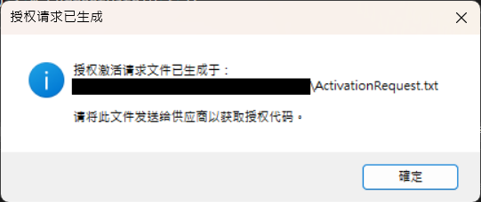

# 软件介绍

## **MyCAM** 是什么

 - CAD／CAM 集成软件系统
 - 专门用于五轴激光切割加工设计
 - 结合计算机辅助设计（CAD）和计算机辅助制造（CAM）功能
 - 提供从 3D 模型导入到 NC 程序输出的完整解决方案

## 基本工作流程

## 应用场景

根据零件的几何形态，**MyCAM** 提供对应的加工操作流程

 - [《异型件加工操作流程》](../2_加工操作流程/2_1_異型件加工操作流程.md)：适用于非旋转对称、形状不规则的零件
 - [《回转体加工操作流程》](../2_加工操作流程/2_2_迴轉體加工操作流程.md)：适用于可绕轴旋转生成的零件

## 使用前准备

### 硬件建议配置

| 硬件 			    | 需求                                  | 
| ---			    | ---                                   | 
| **处理器**        | Intel Core i5-6500 @ 3.20GHz 以上     | 
| **内存**          | 16 GB RAM  以上                       | 
| **显卡**          | 支持 OpenGL 3.3 以上                  |
| **硬盘空间**      | 32 GB 以上可用空间                    | 
| **屏幕分辨率**    | 1920 × 1080                           | 
| **网络**          | 可选                                  | 

### 软件与操作系统需求

| 项目                  | 需求                                      |
| ---                   | ---                                       |
| **操作系统**          | Windows 10 20H2（64 位版） 或更高版本     |
| **.NET Framework**    | .NET Framework 4.8.1 或更高版本           |

## 授权与启动

**MyCAM** 采用授权验证机制
- 双击执行 `MyCAM.exe`
- 系统启动时将自动进行授权验证

### 授权检查流程

> ⚠️ **注意**
>
> 如出现授权验证失败，请联系软件供应商
>
> 

>     
>    <strong>授权验证失败视窗</strong>
> 

### 启动失败的处理方式

| 问题                  | 可能原因                      | 解决方案                      |
| ---                   | ---                           | ---                           |
| 软件无法启动          | .NET Framework 未正确安装     | 安装 .NET Framework 4.8.1     |
| Viewer 初始化错误     | 未安装 VC++ 可再发行组件包    | 安装 VC++ 可再发行组件包      |
| 授权验证失败          | 授权过期或无效                | 联系软件供应商更新授权        |

### 更新授权

 1. 授权验证失败时，点击 **重新进行产品授权**
 2. 系统自动生成授权激活请求文件，将该文件发送给软件供应商以获取新授权文件

     
    <strong>授权请求已生成视窗</strong>

 3. 获取新授权文件，放置于执行目录的 Custom 文件夹下
 4. 重新启动软件，系统将自动重新进行授权验证          

