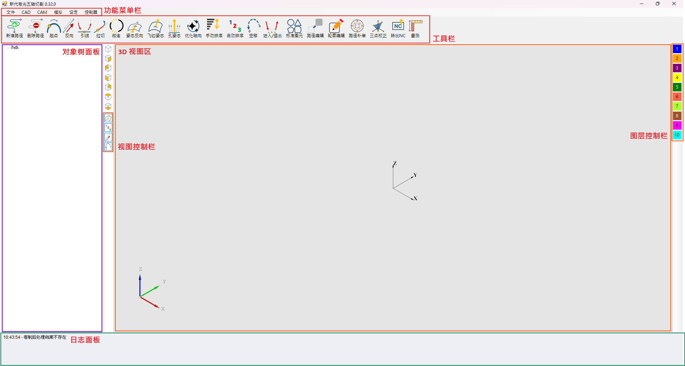
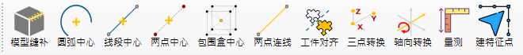
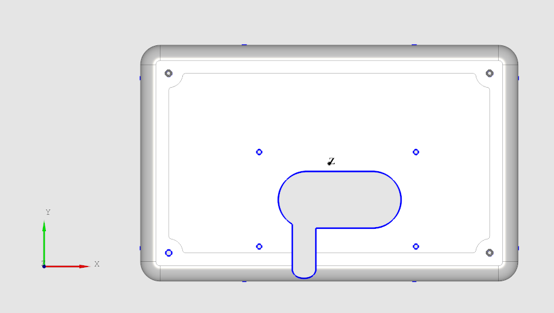
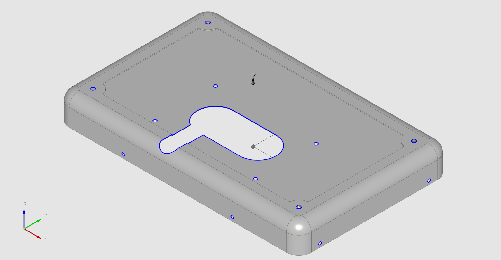
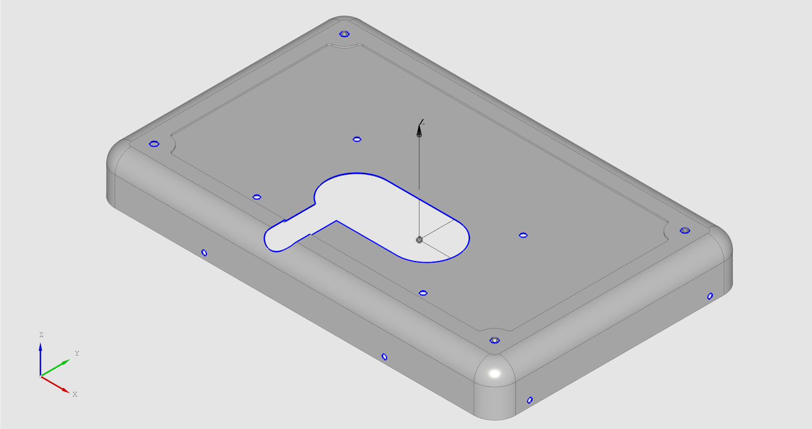
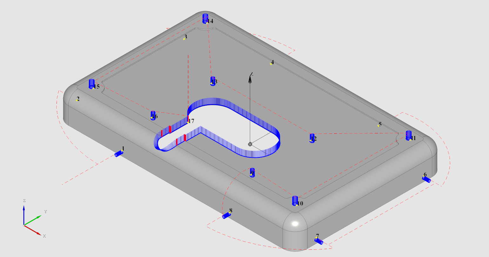
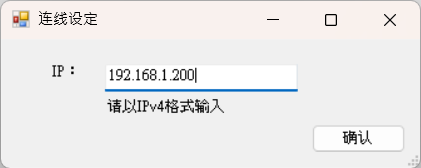
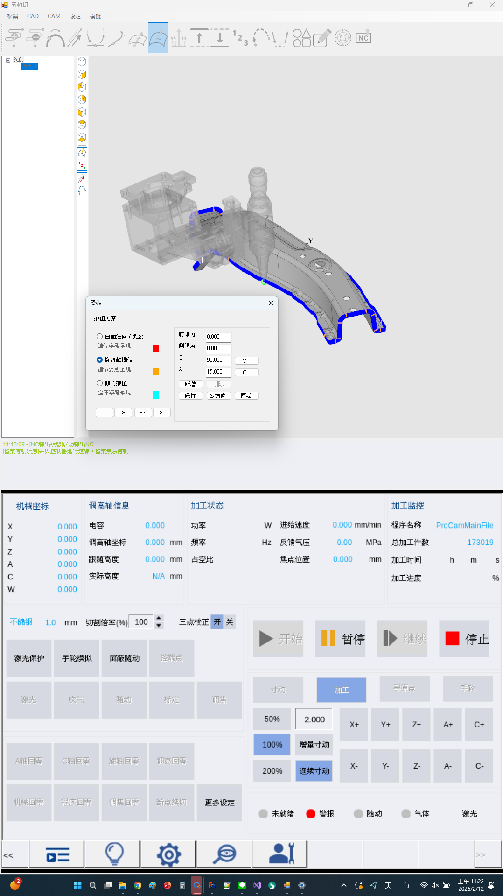

# 主界面与基本操作

## 主界面布局

**MyCAM** 主界面采用模块化设计，由多个功能区域组成，从上到下、从左到右分为以下区域

| 区块位置      | 名称          | 说明                                  |
| ---           | ---           | ---                                   |
| **顶部**      | 功能菜单栏    | 提供文件、CAD、CAM、模拟等主菜单      |
| **上方**      | 工具栏        | 显示当前功能的工具按钮                |
| **左侧**      | 对象树面板    | 显示零件、路径等对象的树状列表        |
| **中央**      | 3D 视图区     | 显示 3D 模型和加工路径的主视图        |
| **右侧**      | 图层控制栏    | 10 个图层的快速切换按钮               |
| **左下方**    | 视图控制栏    | 标准视图切换和显示选项                |
| **下方**      | 日志面板      | 显示操作提示、警告和错误信息          |
| **底部**      | CNC 面板      | CNC 机床的操控窗口（可选）            |
|

<div align="center">
    <br>
    <strong>MyCAM 软件完整主窗口</strong>
</div>

## 功能菜单栏

位于窗口最顶部的主菜单栏，包含以下功能

| 功能名称      | 说明                          |
| ---           | ---                               |
| **文件**      | 3D 模型导入、项目文件读取和保存   |
| **CAD**       | 模型缝补、特征元素创建、零件放置  |
| **CAM**       | 路径生成、编辑、后处理            |
| **模拟**      | 加工模拟、碰撞检测功能            |
| **设置**      | CNC 连接设置等系统配置            |
| **控制器**    | CNC 操控界面                      |
|

## 工具栏

包含当前功能的主要工具按钮

<div align="center">
    <br>
    <strong>CAD 功能工具栏按钮</strong>
</div>

## 对象树面板

位于主画面左侧，以树状结构显示当前项目中的所有对象

 - 查看所有导入的零件和生成的路径
 - 路径树状列表中的对象顺序，即代表实际加工顺序

### 交互操作

| 输入方式  | 操作              | 功能              |
| ---     | ---               | ---               |
| 鼠标      | **单击选择**      | 选择对象进行编辑  |
| 键盘      | **空格键操作**    | 选中对象后按下 **空格键**，显示或隐藏该对象（只适用于零件）    |
|

### 树状结构层级

```
零件（Part）
├── Part1
├── Part2
└── ……

路径（Path）
├── Path1
├── Path2
└── ……
```

## 3D 视图区

位于主画面中央，占据最大面积，用于显示 3D 模型和加工路径

 - 3D 零件模型（灰白色显示）
 - 加工路径（彩色线条，不同图层不同颜色）
 - 根据不同编辑模式显示关键 CAM 工艺数据

### 交互操作

| 操作          | 鼠标操作      | 功能              |
| ---           | ---           | ---               |
| **旋转视图**  | 鼠标右键拖动  | 绕视点旋转视图    |
| **平移视图**  | 鼠标中键拖动  | 平移视图位置      |
| **缩放视图**  | 鼠标滚轮      | 放大或缩小视图    |
| **选择对象**  | 鼠标左键点击  | 选择零件或路径    |
|

## 图层控制栏

位于 3D 视图区右侧，提供 10 个图层的快速切换

| 图层编号  | 颜色      | 用途          |
| ---       | ---       | ---           |
| **1**     | 蓝色      | 默认图层      |
| **2**     | 橙色      | 自定义图层    |
| **3**     | 紫色      | 自定义图层    |
| **4**     | 黄色      | 自定义图层    |
| **5**     | 绿色      | 自定义图层    |
| **6**     | 番茄红    | 自定义图层    |
| **7**     | 黄绿色    | 自定义图层    |
| **8**     | 褐色      | 自定义图层    |
| **9**     | 洋红色    | 自定义图层    |
| **10**    | 青色      | 自定义图层    |
|

> 💡 **提示**
>
> 图层功能可用于区分不同类型的加工路径，详情可见[《路径生成》](../5_CAM功能/5_1_路徑生成.md)

## 视图控制栏

位于 3D 视图区左侧，通过视图控制栏的按钮切换视图和显示选项

| 图示                                          | 按钮      | 视图名称                  | 说明                  |
| ---                                           | ---       | ---                       | ---                   |
|             | **AXO**   | 等轴测视图                | 默认的三维视图        |
|       | **X+**    | X 轴正向视图              | 从 X 轴正方向观看     |
|        | **X-**    | X 轴负向视图              | 从 X 轴负方向观看     |
|        | **Y+**    | Y 轴正向视图              | 从 Y 轴正方向观看     |
|        | **Y-**    | Y 轴负向视图              | 从 Y 轴负方向观看     |
|         | **Z+**    | Z 轴正向视图（俯视图）    | 从 Z 轴正方向观看     |
|      | **Z-**    | Z 轴负向视图（仰视图）    | 从 Z 轴负方向观看     |
|

<div align="center">
    
    <br>
    <strong>视图切换示例</strong>
</div>

## 显示选项控制

通过视图工具栏底部的 4 个切换按钮，控制视图中显示的内容

| 图示                                          | 功能                  | 说明                                              |
| ---                                           | ---                   | ---                                               |
|         | **显示姿态**          | 显示或隐藏刀具姿态向量，检查刀具方向是否正确      |
|       | **显示顺序**          | 显示或隐藏路径顺序编号，确认加工顺序是否符合要求  |
|         | **显示路径方向**      | 显示或隐藏路径方向箭头，检查路径切割方向          |
|   | **显示抬下刀路径**    | 显示或隐藏空移路径，查看完整的刀具运动轨迹        |
|

<div align="center">
    
    <br>
    <strong>显示选项关闭开启效果对比</strong>
</div>

> 💡 **提示**
>
> 点击显示选项按钮，按钮会呈现选中状态（高亮），再次点击可取消选中

## 日志面板

位于主画面下方，显示软件运行过程中的各类信息

 - 自动显示最新信息（自动滚动到底部）
 - 支持鼠标滚轮查看历史信息
 - 可通过滚动条查看完整日志

### 信息类型

| 类型          | 颜色标识  | 说明              | 示例              |
| ---           | ---       | ---               | ---               |
| **提示信息**  | 黑色文字  | 正常操作提示      | "路径已添加"      |
| **警告信息**  | 黄绿文字  | 需要注意的问题    | "重合的第二个点"  |
| **错误信息**  | 红色文字  | 操作失败或异常    | "导入失败"        |
|

<div align="center">
    <br>
    <strong>日志面板信息示例</strong>
</div>

## CNC 操作面板

位于主画面底部，用于控制 CNC

 - 显示机床端的实时画面
 - 监控加工进度
 - 查看机床运行状态

### 使用说明

 - 需要先配置 CNC 连接设置
     - 确认机床端与计算机位于同一网络，或通过网线连接
     - 在连接设置窗口中输入机床端 IP 地址

<div align="center">
    <br>
    <strong>连接设置視窗</strong>
</div>

 - 连接成功后，此面板会显示机床端画面

<div align="center">
    <br>
    <strong>机床端画面</strong>
</div>

## 快捷键

**MyCAM** 提供多种快捷键提高操作效率

| 功能          | 快捷键    | 说明                                  |
| ---           | ---       | ---                                   |
| **隐藏项目**  | **空格键** | 显示或隐藏对象                         |
| **多选对象**  | **Ctrl**  | 按住 Ctrl 并单击，可选择多个不连续的对象 |
| **连续多选**  | **Shift** | 按住 Shift 并单击，可选择连续的对象     |
| **删除对象**  | **Del**   | 删除选中的对象                         |
| **取消操作**  | **Esc**    | 退出当前操作模式                       |
| **AXO 视图**  | **F5**     | 调整至 AXO 视图                        |
| **对正视图**  | **F6**     | 调整至与当前相机位置最接近的平面视图   |
|
