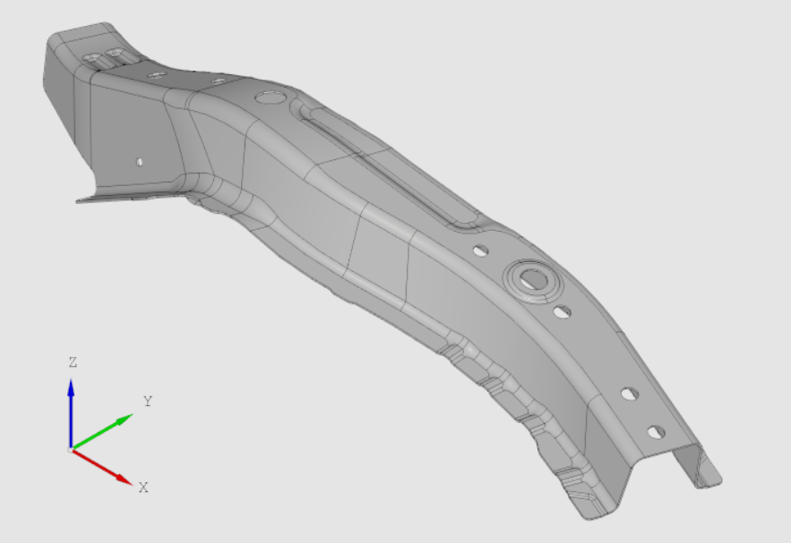
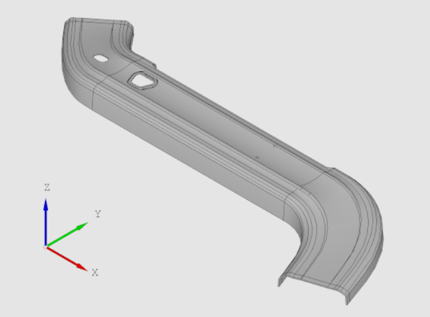
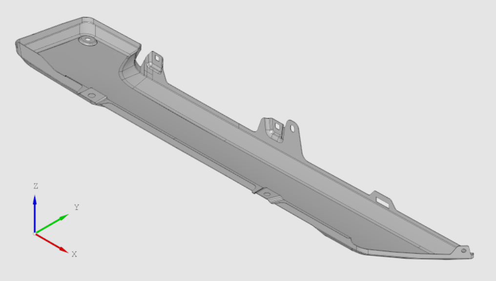

# 异型件加工操作流程

本节说明异型件从模型导入到 NC 输出的完整加工流程。

### 适用场景

 - 零件不具备简单管状或回转对称特征，例如覆盖件、蒙皮及造型件
 - 加工范围可通过连续曲面的外轮廓边界提取

    
    
     
    <b>异型件示意</b> 

### 不适用场景

- 零件为管状或回转对称零件，请改参照[《回转体加工操作流程》](../2_加工操作流程/2_2_迴轉體加工操作流程.md)

## 加工流程总览

## 导入图档

 - 导入异型件的 STEP 或 IGES 格式模型（建议优先使用 STEP 格式以保留较高精度）

[图片：异型件模型导入结果示意]

> 💡 **提示**
>
> 支持格式、详细操作步骤与导入成功标志，请参阅[《文件、格式与项目管理》](../3_檔案、格式與專案管理/3_1_檔案、格式與專案管理.md)

## 特征建立

 - 若模型存在曲面间隙或破孔，需先进行模型缝补
 - 若模型上缺乏明确的坐标建立基准，可依需求建立特征点或特征线作为辅助基准

> 💡 **提示**
>
> 详细操作步骤与参数说明，请参阅[《模型缝补》](../4_CAD功能/4_1_模型縫補.md)、[《特征点》](../4_CAD功能/4_2_特徵點.md)与[《特征线》](../4_CAD功能/4_3_特徵線.md)

## 零件放置

 - 根据前述规划结果，选择以下任一种方式建立工件坐标

   - **工件对齐**：适用仅有单一明确基准（点、轴或面）的情况
   - **三点转换**：适用具备三个明确特征点，需建立完整坐标系的情况

> 💡 **提示**
>
> 详细操作步骤与参数说明，请参阅[《零件放置》](../4_CAD功能/4_3_零件放置.md)

[图片：工件坐标建立结果示意]

## 新增路径

 - 异型件属于复杂曲面零件，可使用 **异形盖件-生成路径** 自动识别外轮廓边界并生成加工路径
 - 若自动生成的路径边界不完整（例如零件存在局部特征或孔洞导致边界提取失败），可改用 **D1 连续** 半自动或 **手动选取** 逐边组合的方式修正或补充

> 💡 **提示**
>
> 详细操作步骤与参数说明，请参阅[《路径生成》](../5_CAM功能/5_1_路徑生成.md)

## 路径排序

 - 异型件不具管状特征，路径排序以最短路径原则为主（不适用圆管专属排序方式）
 - 根据需要调整起点、方向、进入／退出与空移参数

[图片：路径排序设置示意]

> 💡 **提示**
>
> 详细操作步骤与参数说明，请参阅[《路径排序》](../5_CAM功能/5_2_路徑排序.md)与[《路径工序》](../5_CAM功能/5_3_路径工序.md)

## 路径工艺

 - 根据加工需求设置引线、过切与微连等加工工艺，避免起刀和收刀痕迹影响外观或零件在切割后掉落

[图片：路径工艺设置示意]

> 💡 **提示**
>
> 详细操作步骤与参数说明，请参阅[《路径工艺》](../5_CAM功能/5_4_路径工艺.md)

## 自动优化轴向

 - 完成路径排序后、调整姿态前，使用 **自动优化轴向** 对多条路径之间的旋转轴角度进行统一优化，使相邻路径切换更平滑

> 💡 **提示**
>
> 详细操作步骤与参数说明，请参阅[《路径姿态》](../5_CAM功能/5_5_路径姿态.md#优化轴向)

## 姿态调整

 - 调整曲面上的飞边姿态与孔类特征姿态

> 💡 **提示**
>
> 详细操作步骤与参数说明，请参阅[《路径姿态》](../5_CAM功能/5_5_路径姿态.md)

[图片：加工姿态调整前后对比示意]

## 路径模拟

 - 完成路径与姿态设置后，在输出 NC 程序前应先进行模拟，依次确认加工顺序、加工姿态、空移与干涉碰撞等检查项目
 - 若发现异常，依次追溯问题来源（路径生成、顺序、工序或姿态设置），修正对应设置后重新模拟，直到确认结果无误

[图片：模拟检查结果示意]

> 💡 **提示**
>
> 模拟操作、控制方式与检查项目说明，请参阅[《路径模拟》](../6_模擬/6_1_路徑模擬.md#路径模拟)

## 输出程序（三点校正，视情况）

 - 确认模拟完成且无异常后，将排序完成的路径输出为 NC 程序文件；若机床已完成连接设置，NC 文件可直接通过控制器传输至机床
 - 如需修正安装误差，可在输出前使用三点校正，将工件的程序坐标对应至实际测量坐标
 - 如需自定义后处理格式，可参照对应的后处理配置文件

> 💡 **提示**
>
> 三点校正的详细操作步骤，请参阅[《程序输出》](../5_CAM功能/5_7_程序输出.md#三点校正)

> 💡 **提示**
>
> 输出程序的详细操作步骤，请参阅[《程序输出》](../5_CAM功能/5_7_程序输出.md#转出nc)

## 路径编辑（视情况）

 - 如需对已输出的路径进行局部修正，可使用位置补偿、尺寸补偿或轮廓编辑功能

> 💡 **提示**
>
> 详细操作步骤与参数说明，请参阅[《路径编辑》](../5_CAM功能/5_6_路径编辑.md)