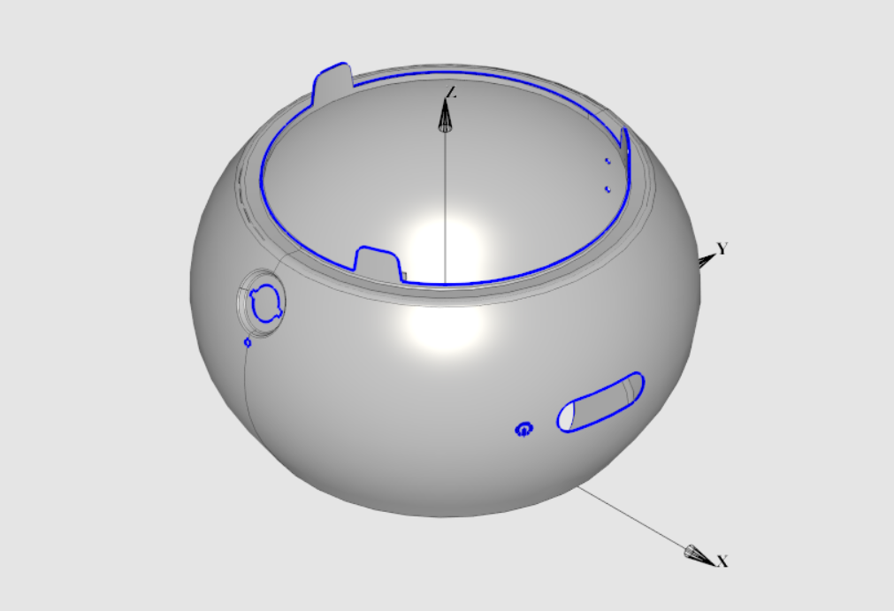
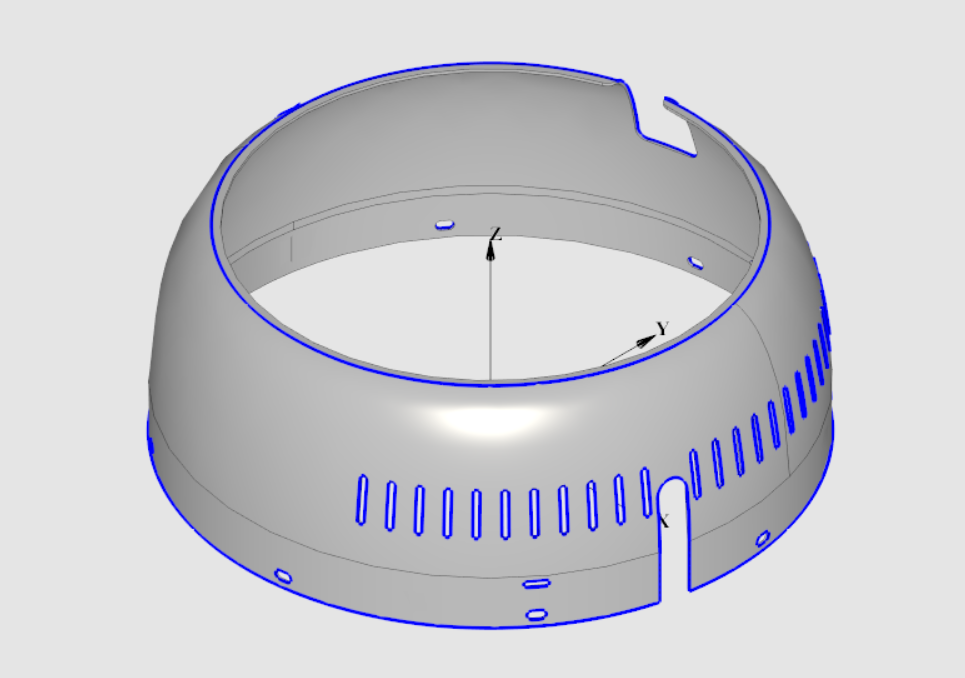
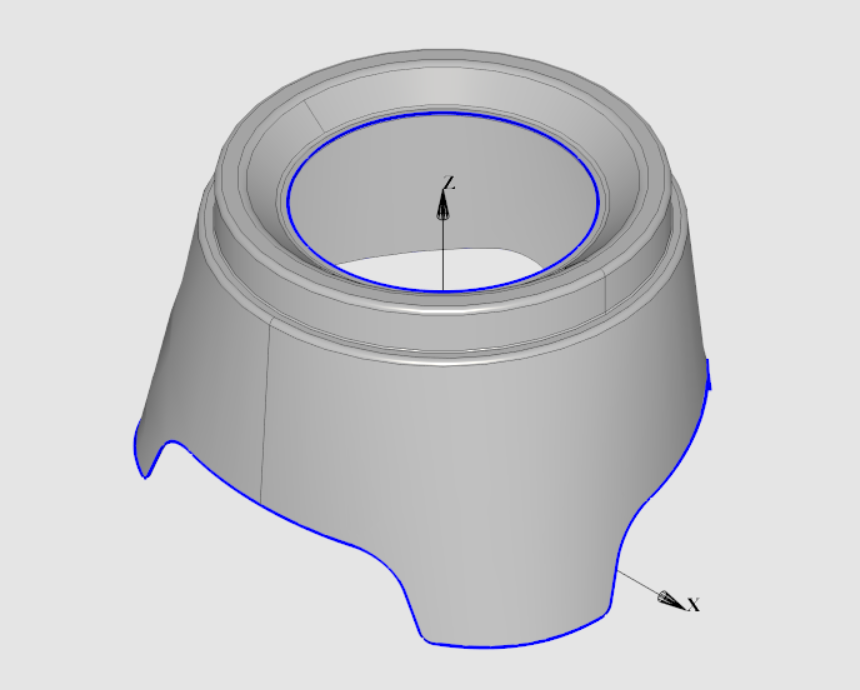

# 回转体加工操作流程

本节说明回转体从模型导入到 NC 输出的完整加工流程。

### 适用场景

- 零件具备管状或回转对称特征，例如圆管、排气管及结构管材
- 加工路径可沿拉伸轴或旋转轴生成

    
    
     
    <b>回转体示意</b> 

### 不适用场景

- 零件为不具管状或回转对称特征的复杂曲面零件，请改参照[《异型件加工操作流程》](../2_加工操作流程/2_1_異型件加工操作流程.md)

## 加工流程总览

## 导入回转体

 - 导入回转体的 STEP 或 IGES 格式模型（建议优先使用 STEP 格式以保留较高精度）
 - 模型导入成功后，软件会自动将坐标转到工件中心，并生成初始路径

[图片：回转体模型导入结果示意]

> 💡 **提示**
>
> 支持格式、详细操作步骤与导入成功标志，请参阅[《文件、格式与项目管理》](../3_檔案、格式與專案管理/3_1_檔案、格式與專案管理.md)

 - 若模型存在曲面间隙或破孔，需先进行模型缝补；若模型上缺乏明确的坐标与旋转轴建立基准，可根据需要建立特征点或特征线作为辅助基准

> 💡 **提示**
>
> 详细操作步骤与参数说明，请参阅[《模型缝补》](../4_CAD功能/4_1_模型縫補.md)与[《特征》](../4_CAD功能/4_2_特徵.md)

 - 若需手动建立或调整工件坐标与旋转轴，使拉伸轴／回转轴与 Z 轴对齐，可选择 **工件对齐（轴向对齐）**（选择零件上的一条直边或圆弧，将其轴心与 X／Y／Z 轴重合）或 **三点转换**（适用具备三个明确特征点，需建立完整坐标系的情况）

[图片：工件坐标与旋转轴建立结果示意]

> 💡 **提示**
>
> 详细操作步骤与参数说明，请参阅[《零件放置》](../4_CAD功能/4_3_零件放置.md)

 - 若初始路径边界不完整，可使用 **管拉件-生成路径** 重新识别管材特征并生成路径，或改用 **所有面边界** 半自动及 **手动选取** 逐边组合的方式修正或补充；若零件同时具备复杂曲面特征，可根据实际需要改用 **异形盖件-生成路径** 自动生成方式

[图片：回转体路径生成结果示意]

> 💡 **提示**
>
> 详细操作步骤与参数说明，请参阅[《路径生成》](../5_CAM功能/5_1_路徑生成.md)

## 自动排序

 - 回转体具备管状或回转对称特征，可根据需要选用 **圆管直排**（沿拉伸轴方向从上到下或从下到上）或 **圆管横排**（沿圆周方向顺时针或逆时针）等自动排序方式，也可使用最短路径或手动排序

[图片：路径排序结果示意]

> 💡 **提示**
>
> 详细操作步骤与参数说明，请参阅[《路径排序》](../5_CAM功能/5_2_路徑排序.md)

## 工艺调整（批量调）

 - 根据需要设置路径起点、方向、进入／退出与空移参数
 - 设置引线、过切与微连等加工工艺，避免起刀和收刀痕迹影响外观或零件在切割后掉落

[图片：路径工艺设置示意]

> 💡 **提示**
>
> 详细操作步骤与参数说明，请参阅[《路径工序》](../5_CAM功能/5_3_路径工序.md)与[《路径工艺》](../5_CAM功能/5_4_路径工艺.md)

## 孔姿态调适（批量调）

 - 回转体常见孔类或圆周特征，可使用 **孔姿态** 将路径统一设置为固定角度
 - 其中 **锁轴切割** 子功能适用于圆管等旋转对称零件对稳定切割角度的需求
 - 曲面局部飞边姿态与姿态反向，用于个别路径的姿态微调

[图片：加工姿态调整前后对比示意]

> 💡 **提示**
>
> 详细操作步骤与参数说明，请参阅[《路径姿态》](../5_CAM功能/5_5_路径姿态.md)

## 优化轴向

 - 完成排序与姿态设置后，使用 **优化轴向** 对多条路径之间的旋转轴角度进行统一优化，提高相邻路径切换时的平滑度
 - 若姿态或位置仍需微调，可进一步使用位置补偿、尺寸补偿或轮廓编辑功能

> 💡 **提示**
>
> 详细操作步骤与参数说明，请参阅[《路径姿态》](../5_CAM功能/5_5_路径姿态.md#优化轴向)与[《路径编辑》](../5_CAM功能/5_6_路径编辑.md)

## 模拟检查

 - 完成路径与姿态设置后，在输出 NC 程序前应先进行模拟，依次确认加工顺序、加工姿态、空移与干涉碰撞等检查项
 - 若发现异常，依次追溯问题来源（路径生成、顺序、工序或姿态设置），修正对应设置后重新模拟，直到确认结果无误

[图片：模拟检查结果示意]

> 💡 **提示**
>
> 模拟操作、控制方式与检查项目说明，请参阅[《路径模拟》](../6_模擬/6_1_路徑模擬.md)

## 输出程序

 - 确认模拟完成且无异常后，将排序完成的路径输出为 NC 程序文件；若机床已完成连接设置，NC 文件可直接通过控制器传输至机床
 - 如需自定义后处理格式，可参照对应的后处理配置文件

> 💡 **提示**
>
> 详细操作步骤，请参阅[《程序输出》](../5_CAM功能/5_7_程序输出.md#转出nc)

