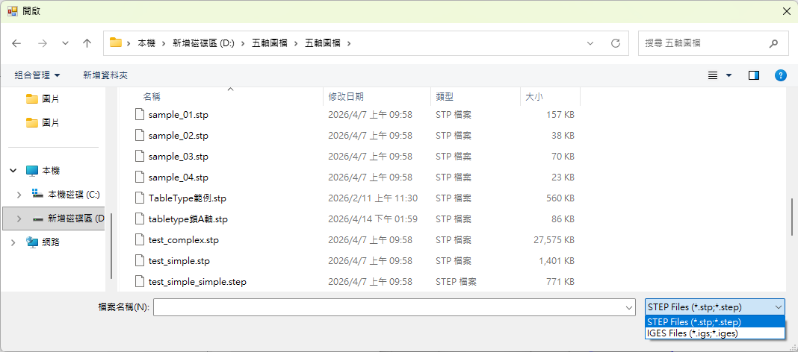
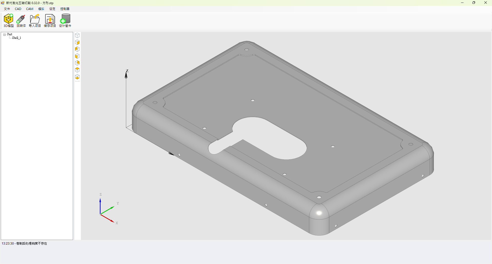
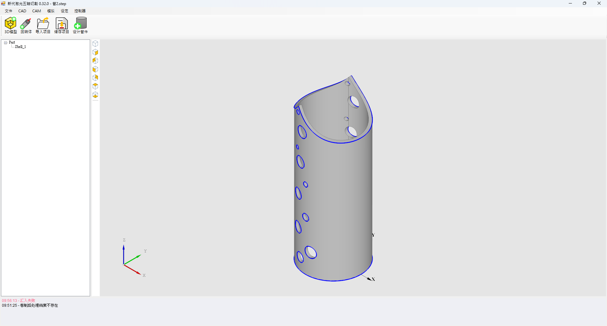
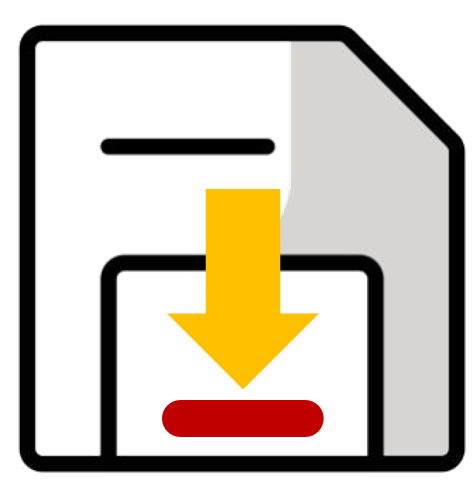
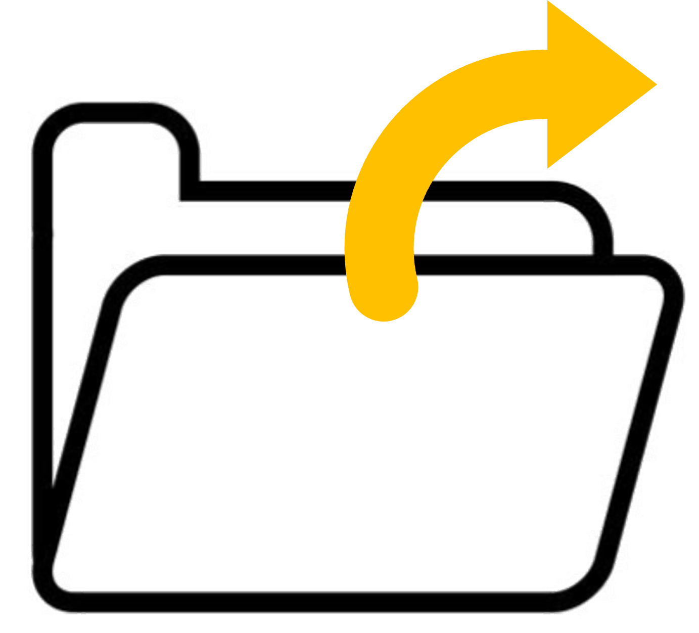
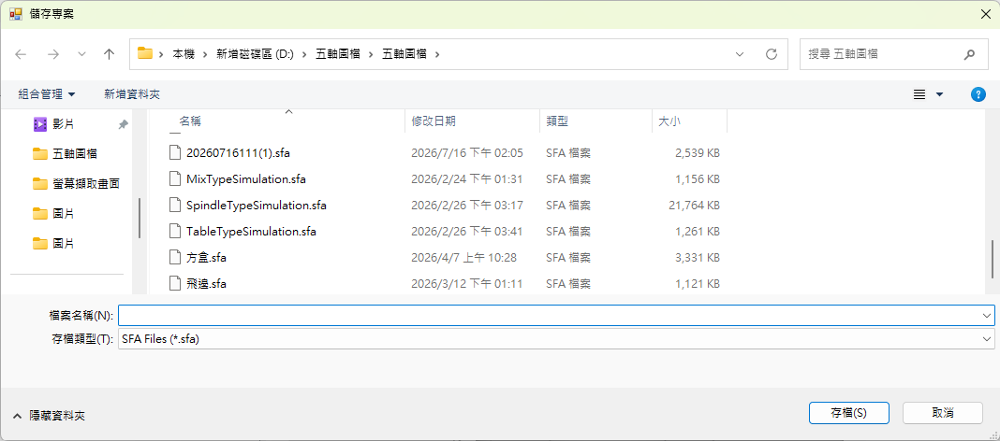
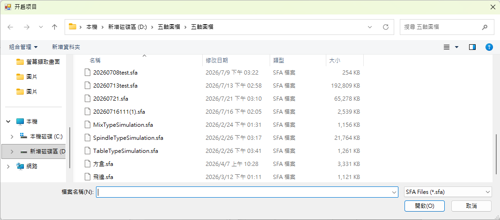

# 文件、格式与项目管理

## 导入模型

 - **MyCAM** 支持导入 3D 模型和回转体，用于建立加工项目的零件数据

| 图示 | 方法 | 說明 |
| --- | --- | --- |
|  | **3D模型** | 导入 3D 模型文件 |
|  | **回转体** | 导入回转体文件 |
|

### 支持的文件格式

| 格式  | 扩展名            | 精度  | 推荐  | 适用场景                              |
| ---   | ---               | ---   | ---   | ---                                   |
| STEP  | `.step`、`.stp`   | 高    | 是    | 精密加工，保留完整几何信息            |
| IGES  | `.iges`、`.igs`   | 低    | 否    | 较轻量的 3D 文件格式，信息可能丢失    |
|

> 💡 **提示**
>
> 优先使用 STEP 格式，可保留完整的拓扑结构和几何精度，IGES 格式兼容性好但精度略低

### 导入 3D 模型

#### 操作步骤

 1. 点击 **文件** 菜单
 2. 点击工具栏 **3D模型** 按钮
 3. 在文件对话框中选择模型文件
 4. 点击 **打开** 按钮或双击模型文件

     

 5. 模型显示在中央视图区，对象树 **零件** 节点下添加新模型

     

### 导入回转体

#### 操作步骤

 1. 点击 **文件** 菜单
 2. 点击工具栏 **回转体** 按钮
 3. 在文件对话框中选择模型文件
 4. 点击 **打开** 按钮或双击模型文件

     

 5. 软件自动将坐标转到工件中心，并生成初始路径

     

### 导入结果与注意事项

 - 导入 3D 模型后，模型显示在中央视图区，对象树 **零件** 节点下添加新模型
 - 导入回转体后，对象树 **路径** 节点下显示自动生成的初始路径

> ⚠️ **注意**
>
> - 大型模型导入可能需要数十秒至数分钟
> - 导入过程中请勿关闭软件
> - 建议在源 CAD 编辑软件中预先检查模型质量

### 导入常见问题

| 问题              | 可能原因              | 解决方案                      |
| ---               | ---                   | ---                           |
| 显示"导入失败"    | 文件损坏或格式错误    | 重新导出模型，确认文件扩展名  |
| 模型显示不完整    | 包含无效几何          | 在源 CAD 中修复模型           |
| 加载时间过长      | 模型过于复杂          | 简化模型或分割导入            |
| 模型位置偏移      | 坐标系不匹配          | 使用零件放置功能调整          |
|

## 项目文件管理

 - **MyCAM** 使用项目文件保存完整的项目数据，方便后续编辑和共享

### 文件说明

 - 扩展名：`.sfa`（SFA Files）
 - 兼容性：新版 MyCAM 可读取所有旧版本建立的 `.sfa` 项目文件

### 项目文件保留的数据

| 数据类型            | 说明                  |
| ---                     | ---                   |
| **3D 模型几何**          | 完整的零件几何数据    |
| **加工路径**             | 所有生成的路径信息    |
| **加工工艺**            | 每个路径点的姿态向量  |
| **三点校正数据**        | 零件放置参数          |
|
> ⚠️ **注意**
>
> 视图状态（当前视角、显示选项）不保存

| 图示 | 功能 | 用途 |
| --- | --- | --- |
|  | **保存项目** | 将当前项目数据保存为 `.sfa` 项目文件 |
|  | **导入项目** | 打开已有的 `.sfa` 项目文件并加载项目数据 |
|

### 保存项目

 - 通过 **保存项目** 按钮，将当前项目数据保存为 `.sfa` 项目文件

#### 操作步骤

 1. 点击 **文件** 菜单
 2. 点击 **保存项目** 按钮
 3. 选择保存位置并输入文件名
 4. 点击 **保存** 按钮

     

> 💡 **提示**
>
>  - 定期保存项目，避免数据丢失
> - 使用有意义的文件名（如：零件名_日期）
> - 重要项目建议保存多个版本备份

### 导入项目

 - 通过 **导入项目** 按钮，打开已有的 `.sfa` 项目文件

#### 操作步骤

 1. 点击 **文件** 菜单
 2. 点击 **导入项目** 按钮
 3. 选择 `.sfa` 项目文件
 4. 点击 **打开** 按钮或双击选中文件
 5. 软件自动加载所有数据

 

     

> 💡 **提示**
>
>  - 所有零件显示在对象树 **零件** 节点
> - 所有路径显示在对象树 **路径** 节点
> - 视图区显示完整的模型和路径
> - 所有参数恢复到保存时的状态
