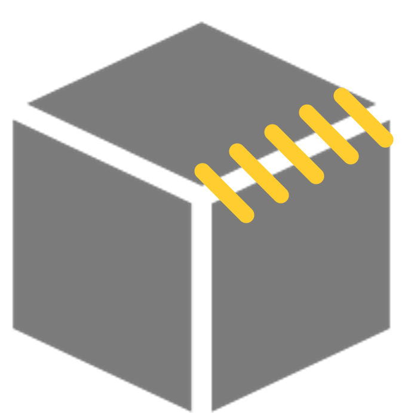

# 模型缝补

**模型缝补**功能用于修复导入模型的拓扑缺陷，确保模型完整性

 - 修复模型中的缝隙和间隙
 - 合并分离的面片
 - 确保模型的拓扑连续性
 - 为后续路径生成提供完整的几何基础

| 图示 										| 方法 				|
| --- 										| --- 				|
|  			| **模型缝补** 		|
|

## 适用场景

 - 从 CAD 系统导入的模型存在间隙
 - 模型包含多个分离的面片需要合并

## 模型缝补参数

| 参数 		| 默认值 	| 说明 					| 建议范围 			|
| --- 		| --- 		| --- 					| --- 				|
| **缝补精度** 	| 0.001 mm 	| 允许合并的最大间隙 	| 0.001～0.1 mm 	|
|

> 💡 **提示**
>
> - 容差值越小，缝补精度越高，但可能无法修复较大的间隙
> - 容差值越大，修复能力越强，但可能改变原始几何形状
> - 建议先使用默认值，如果效果不理想再调整

## 操作步骤

 1. 点击 **CAD** 菜单
 2. 在对象树中选择需要缝补的零件
 3. 在工具栏点击 **模型缝补** 按钮
 4. 在对话框中设置缝补精度（默认 0.001 mm）
 5. 点击 **OK** 按钮
 6. 等待软件完成缝补处理
 7. 确认模型在视图中正常显示且边缘连续无断裂

## 常见问题

| 问题 				| 原因 			| 解决方案 				|
| --- 				| --- 			| --- 					|
| 缝补后仍有间隙 	| 容差设置过小 	| 增加缝补容差值 		|
| 模型形状改变 		| 容差设置过大 	| 减小缝补容差值 		|
| 缝补失败 			| 模型缺陷严重 	| 在源 CAD 中修复模型 	|
|
