# 特征

 - 特征用于在模型上标记特定的几何位置（如圆心、边的中点等）
 - 生成的特征可作为后续对齐、测量或零件放置的参考依据

**MyCAM** 提供 5 种特征点创建方法，以及 1 种特征线创建方法

| 图示 										| 方法 				| 说明 						| 用途 					|
| --- 												| --- 				| --- 						| --- 					|
| 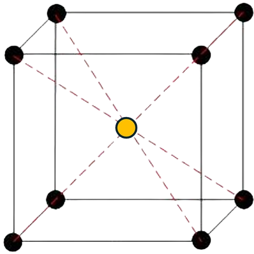 	| **包围盒中心** 	| 计算整个模型的包围盒中心 	| 定位模型的中心位置 	|
| 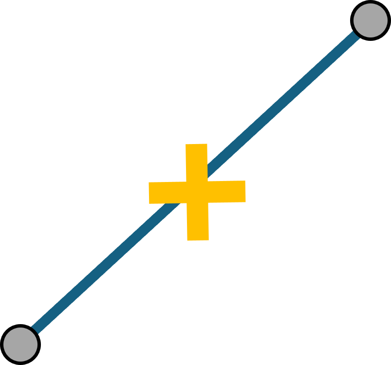 		| **线段中心** 		| 选择直线边创建中点 		| 定位边的中心位置 		|
| 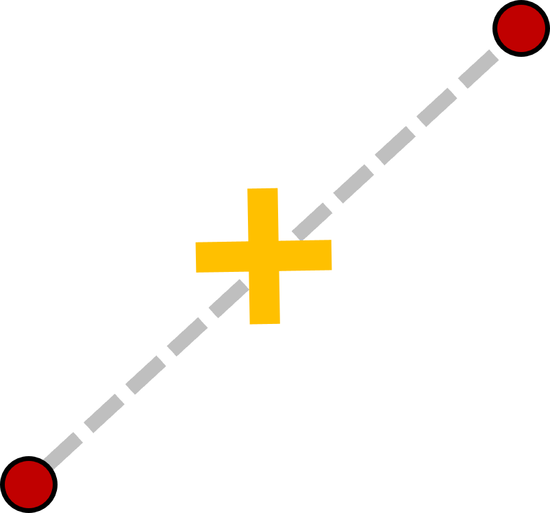 		| **两点中心** 		| 选择两个顶点创建中点 		| 定位两点间的中心 		|
|  			| **圆弧中心** 		| 选择圆弧边创建中心点 		| 定位圆孔、圆弧特征 	|
|    | **两点连线** 		| 选择两个顶点，创建连接这两点的直线    | 定位两点间的连线方向 	|
|      | **建特征点**      | 在模型轮廓上创建指定位置的特征点      | 定位模型轮廓上的指定位置 |

## 包围盒中心

### 操作步骤

 1. 点击 **CAD** 菜单
 2. 点击 **包围盒中心** 按钮
 3. 软件自动计算模型的包围盒
 4. 软件自动计算并创建包围盒中心点
 5. 软件将工件中心移动至坐标系原点

    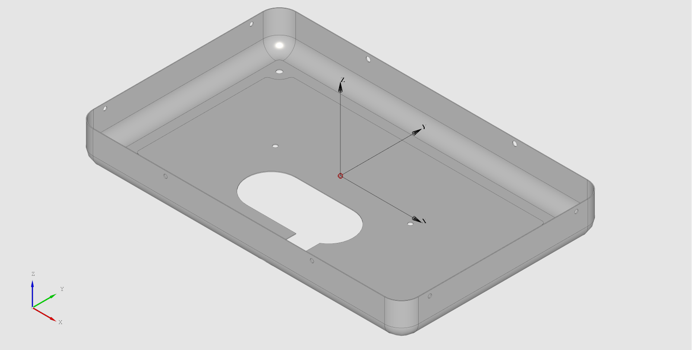 

> 💡 **提示**
>
> 生成的特征点会显示在 3D 视图中对应位置，并可在对象树中查看

## 线段中心

### 操作步骤

 1. 点击 **CAD** 菜单
 2. 在工具栏点击 **线段中心** 按钮
 3. 在 3D 视图中点击选择直线边（会高亮显示对象）

    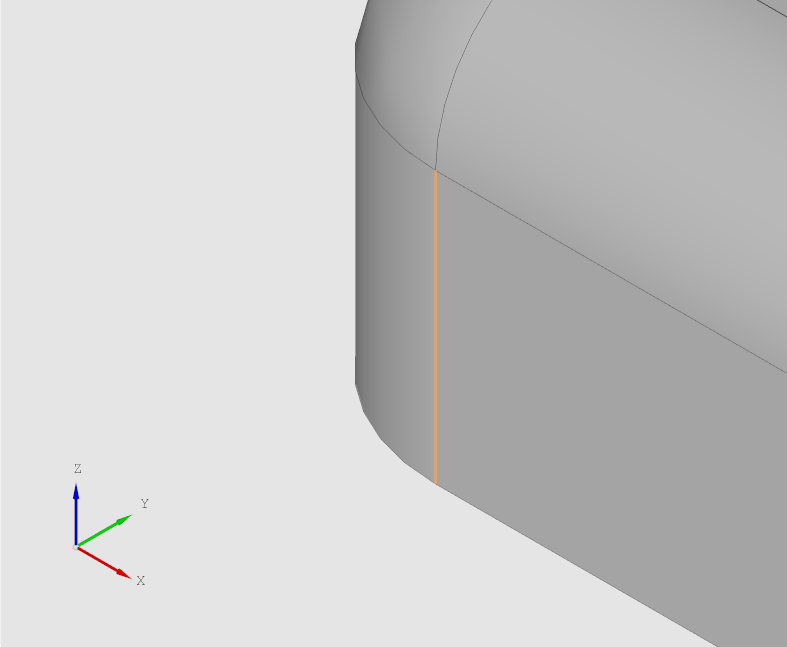 

 4. 软件自动计算并创建线段的中点

    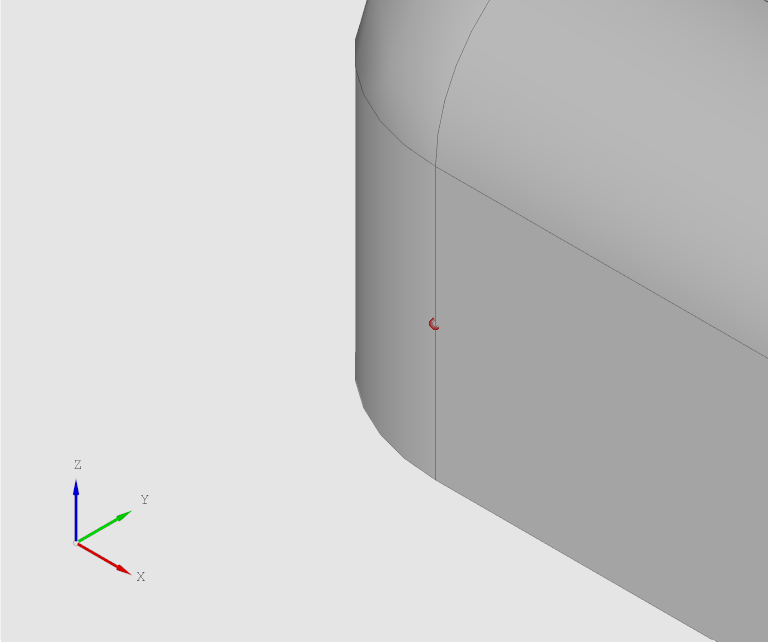 

## 两点中心

### 操作步骤

 1. 点击 **CAD** 菜单
 2. 点击 **两点中心** 按钮
 3. 在 3D 视图中依次点击选择两个顶点（会高亮显示对象）

    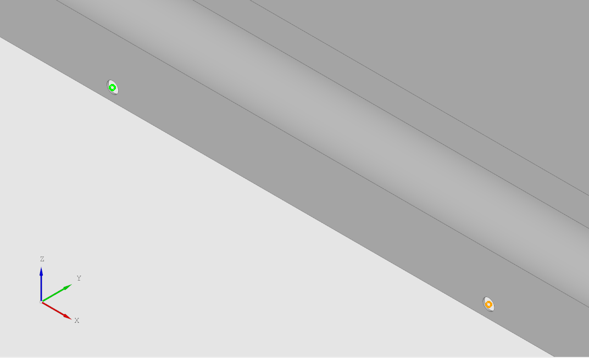 

 4. 软件自动计算并创建两点连线的中点

    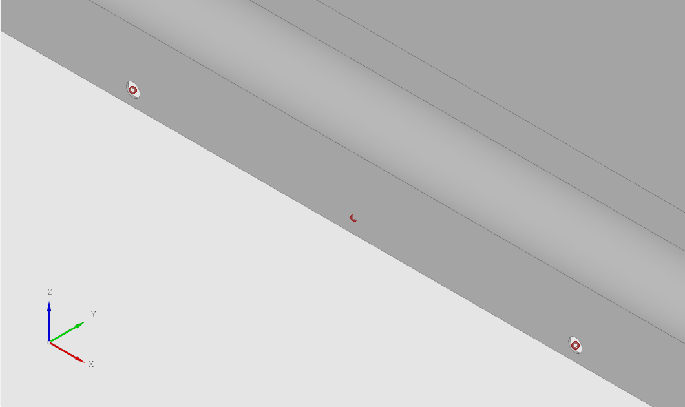 

## 圆弧中心

### 操作步骤

 1. 点击 **CAD** 菜单
 2. 在工具栏点击 **圆弧中心** 按钮
 3. 在 3D 视图中点击选择圆弧边（会高亮显示对象）

    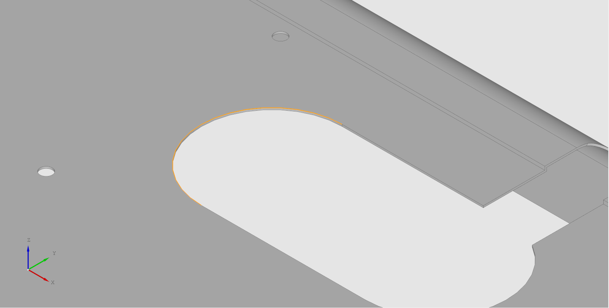 

 4. 软件自动计算并创建圆弧中心点

    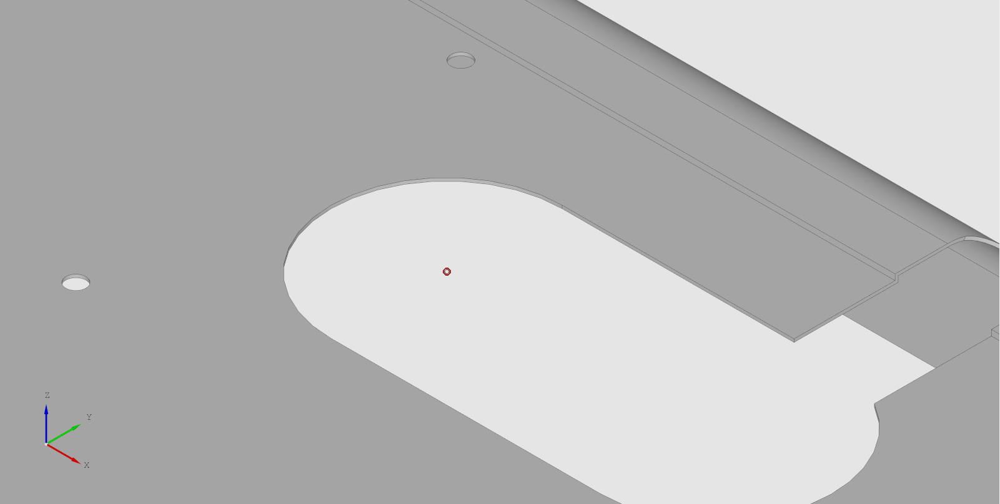 

## 两点连线

### 操作步骤

 1. 点击 **CAD** 菜单
 2. 点击 **两点连线** 按钮
 3. 在 3D 视图中点击第一个顶点
 4. 点击第二个顶点

    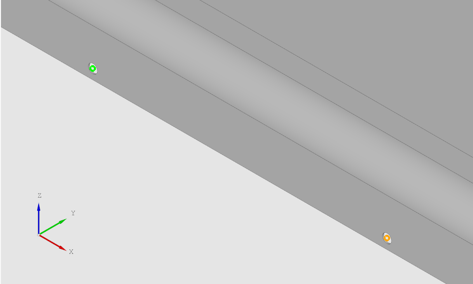 

 5. 软件自动创建连接线

    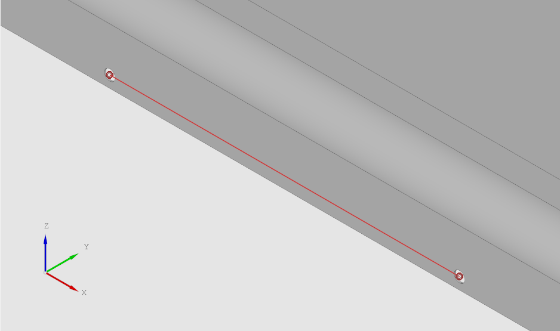 

## 建特征点

### 操作步骤

 1. 点击 **CAD** 菜单
 2. 点击 **建特征点** 按钮
 3. 在 3D 视图中点击需要创建特征点的模型轮廓

    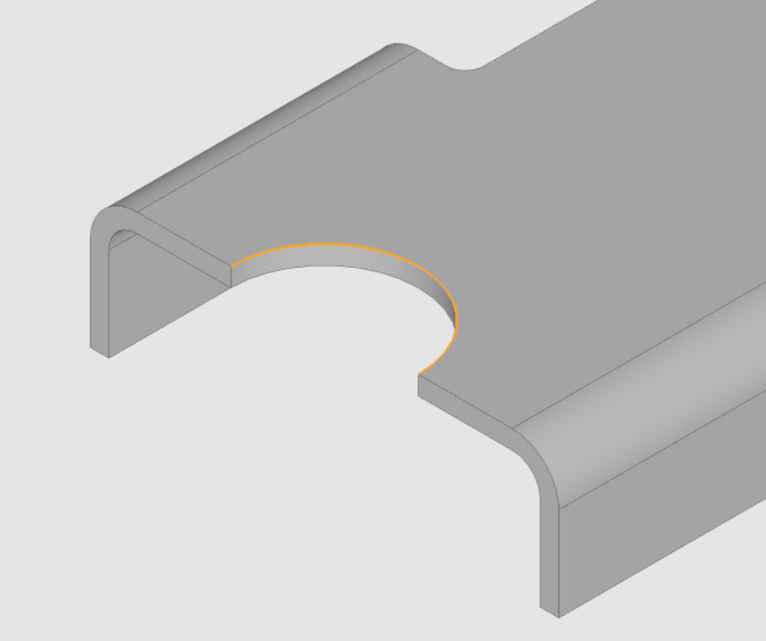 

 4. 软件显示该轮廓上可创建特征点的位置

    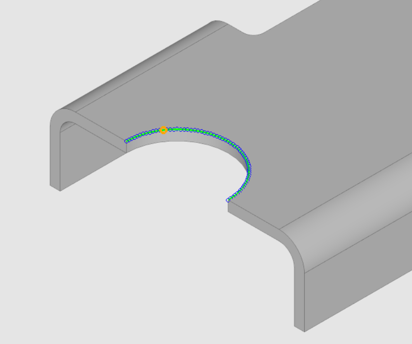 

 5. 点击目标位置，创建特征点

 

    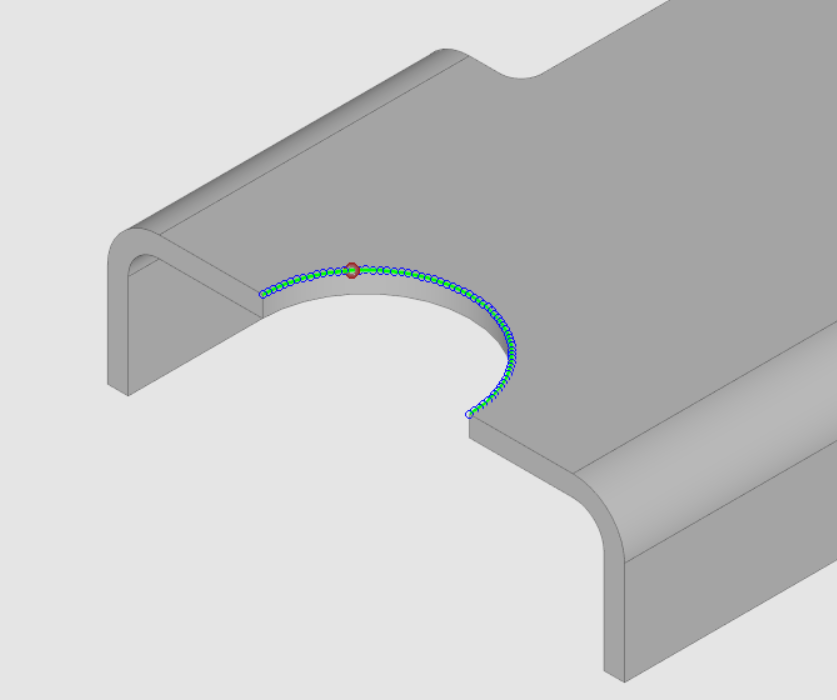 

