# 零件放置

将工件模型在软件中的坐标对齐到机床的实际加工坐标系，确保生成的加工路径与实际工件位置一致

**MyCAM** 提供 3 种零件放置方法

| 图示 												| 方法 		    | 适用场景 						|
| --- 												| ---  		    | --- 							|
|  	| **工件对齐**  | 单一约束对齐（点、轴、面）	|
|  		| **三点转换**  | 完整坐标系建立 				|
| 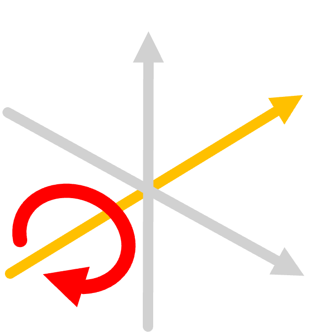 			| **轴向转换**  | 直接操作画布进行零件放置 		|
|

> 💡 **提示**
>
> - 可以多次使用不同的零件放置方式来完成复杂的定位
> - 每次转换后可通过标准视图检查结果

## 工件对齐

 - 通过选择工件上的几何特征（点、边、面），将其与机床坐标系的基准对齐
 - 适用于较复杂的零件对齐场景

| 对齐方式 		| 选择对象 				| 对齐目标 			| 说明 									|
| --- 			| --- 					| --- 				| --- 									|
| **点对齐** 	| 选择一个顶点 			| 坐标原点 			| 将选择的点移动到原点 					|
| **轴向对齐** 	| 选择一条直边或圆弧 	| X／Y／Z 轴 			| 将选择的直线边或圆弧轴心与坐标轴重合 	|
| **轴向平行** 	| 选择一条直边或圆弧 	| X／Y／Z 轴 			| 将选择的直线边或圆弧轴心与坐标轴平行 	|
| **平面对齐** 	| 选择一个平面 			| XY／YZ／XZ 平面 	| 将选择的平面与坐标平面重合 			|
| **平面平行** 	| 选择一个平面 			| XY／YZ／XZ 平面 	| 将选择的平面与坐标平面平行 			|
|

### 操作步骤（以点对齐为例）

 1. 点击**工件对齐**按钮
 2. 在弹出的对话框中选择对齐方式：**点对齐**
 3. 选择对齐目标：**原点**

    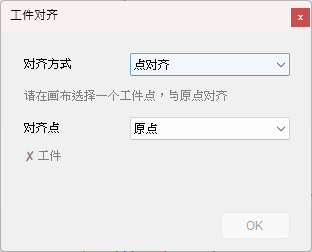 

 4. 在 3D 视图中点击选择工件上的一个顶点
 5. 点击 **确认** 按钮

    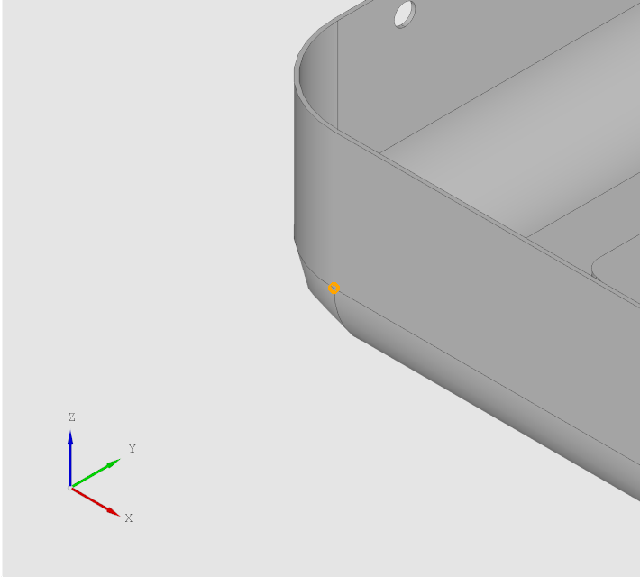
    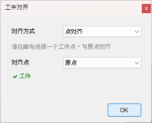 

 6. 工件会自动移动，使选择的点与原点重合

 

    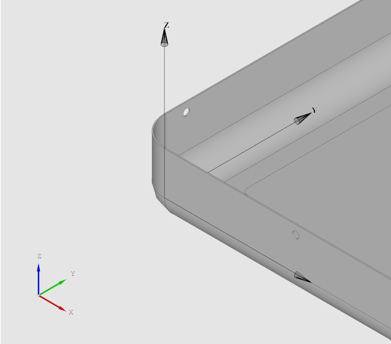 

### 操作步骤（以轴向对齐为例）

 1. 点击 **工件对齐** 按钮
 2. 在对话框中选择 **轴向对齐**
 3. 选择对齐轴：**X 轴**（或 Y 轴、Z 轴）

    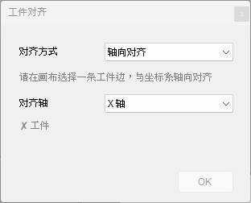 

 4. 在 3D 视图中点击选择工件上的一条边
 5. 点击 **确认** 按钮

    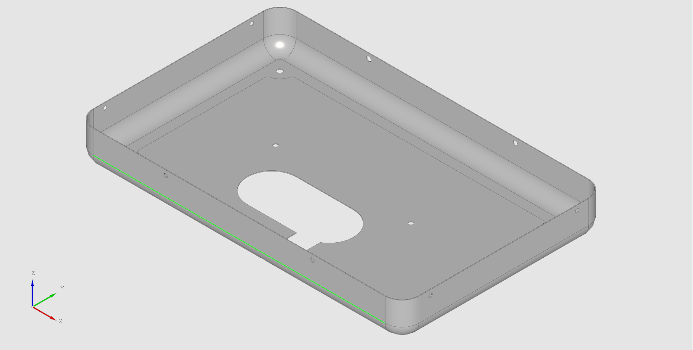
    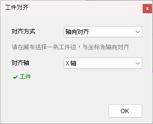 

 6. 工件会旋转，使选择的边与 X 轴重合

    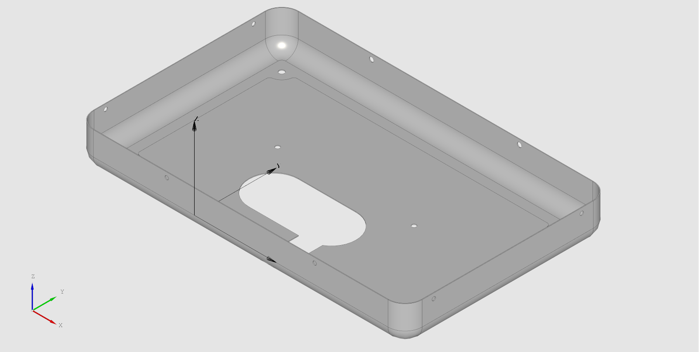 

## 三点转换

 - 通过在工件上选择三个点，建立工件坐标系，然后将其转换到机床坐标系
 - 适用于需要将现场状态直接移植到 CAM 系统上，且有三个明确特征点的场景

    
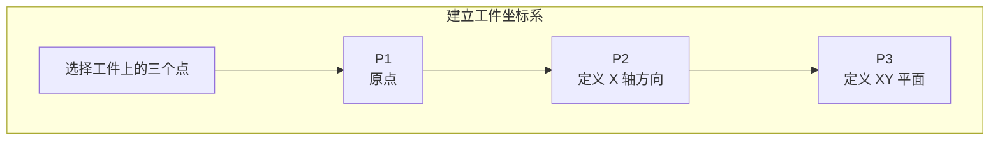

> ⚠️ **注意**
>
> - 三个点不能重合
> - 三个点不能共线
> - 建议选择容易测量的特征点

### 操作步骤

 1. 点击 **三点转换** 按钮
 2. 在 3D 视图中依次选择工件上的三个顶点

    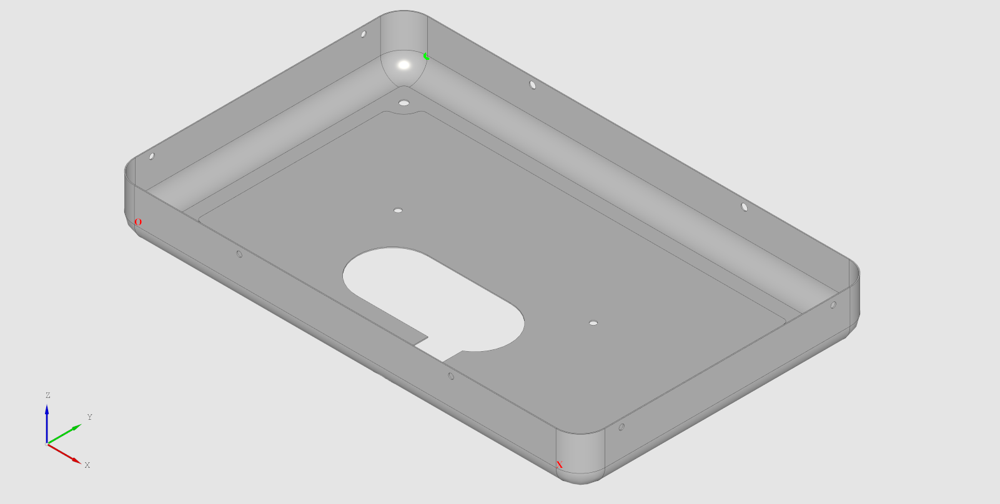 

 3. 在弹出的对话框中输入机床坐标系的对应三点坐标
 4. 点击 **确认** 按钮

    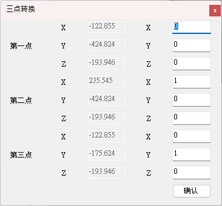 

 5. 工件会根据两组三点的对应关系进行转换

    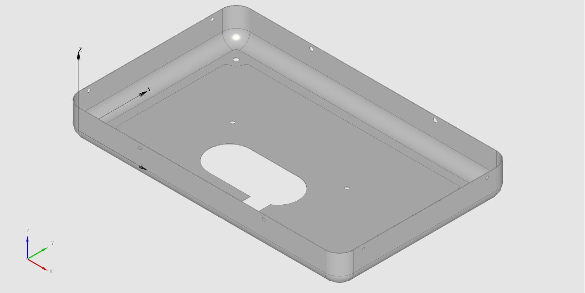 

## 轴向转换

 - 允许用户直接操作画布，对工件进行零件放置
 - 适用于将零件快速放置到大致位置的场景

### 操作步骤

 1. 点击 **轴向转换** 按钮
 2. 通过 3D 视图区上的操作子或输入窗口调整零件位置

    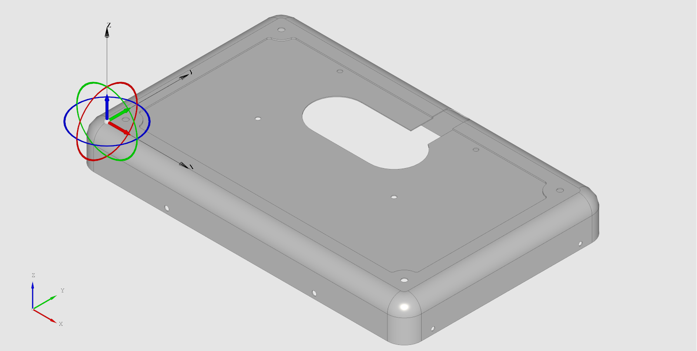
    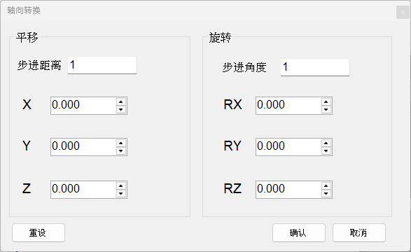 

 3. 点击 **确认** 结束

> ⚠️ **注意**
>
> - 按 **Esc** 或是点击 **取消**，修改會不生效