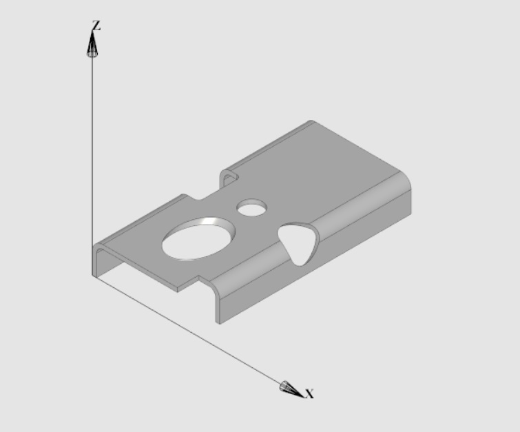
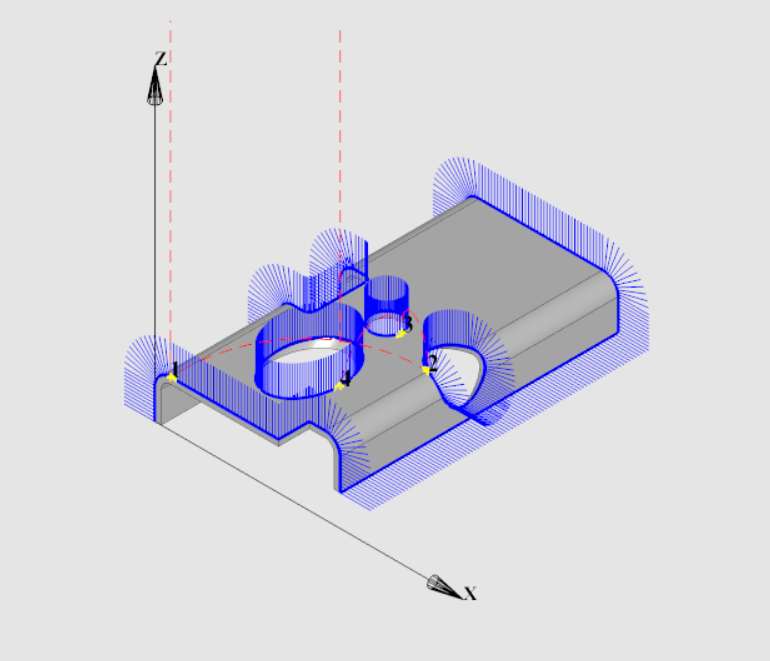
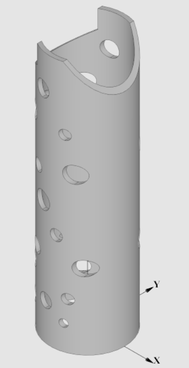
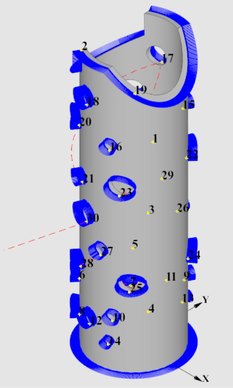
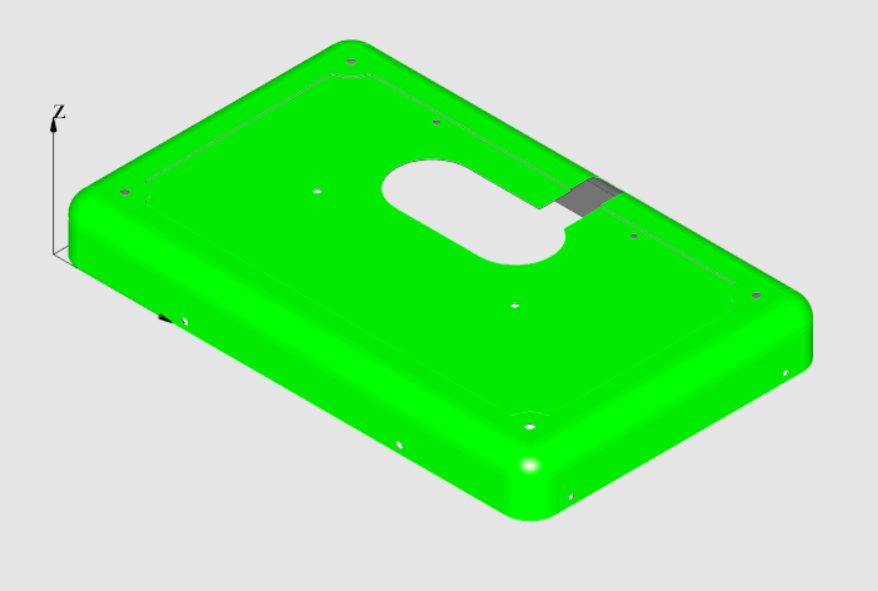
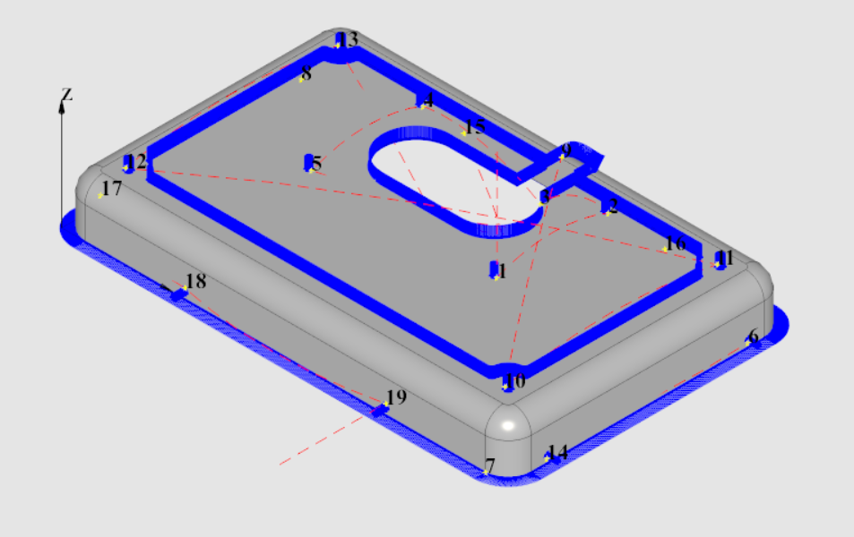
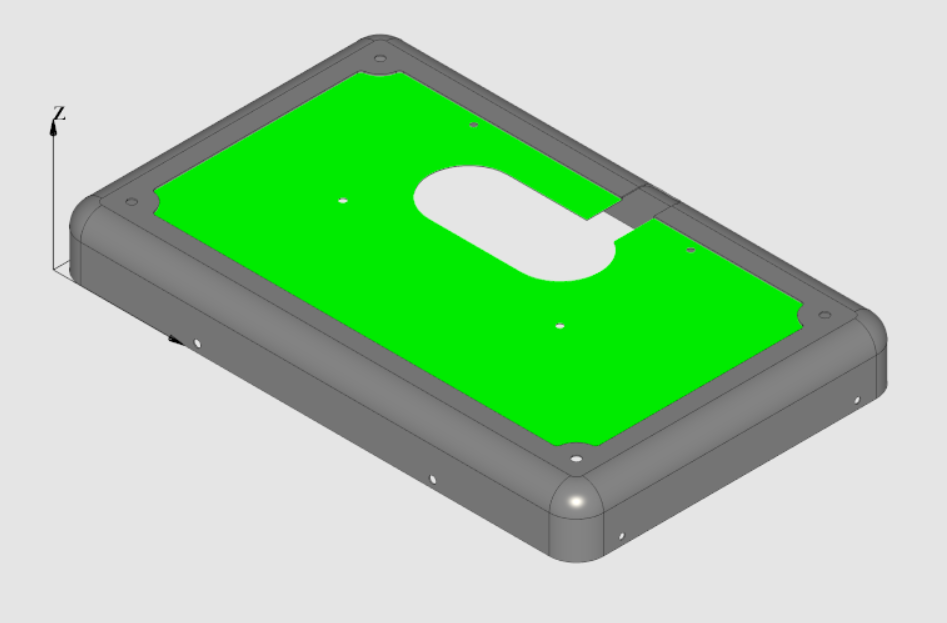
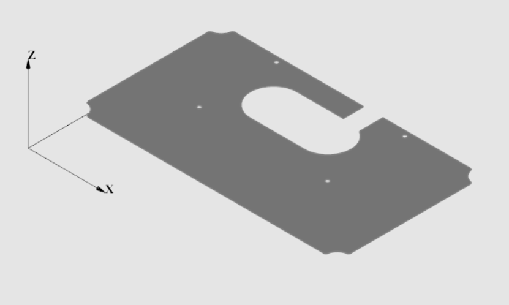
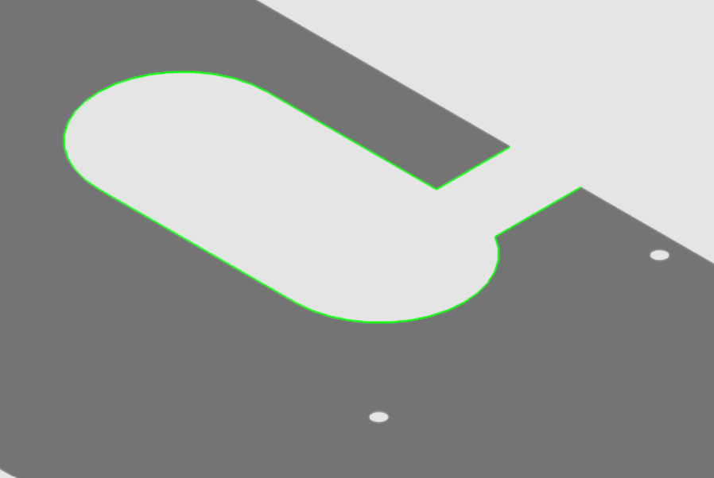

# 路径生成

 - **MyCAM** 提供多种路径生成方式，适应不同的加工需求
 - 可从 3D 模型中提取加工轮廓，生成刀具路径

| 图示 									            | 方法 	        | 说明 						                | 用途 					        |
| --- 										        | --- 		    | --- 						                | --- 					        |
|  	    | **新增路径**  | 用于创建新的加工路径，支持多种生成方式    | 生成刀具路径的起点            |
|      | **删除路径**  | 用于移除不需要的加工路径                  | 清理误生成或不再需要的路径    |
|

| 生成方式 		    | 适用对象 	    | 自动化程度 	| 推荐场景 				        |
| --- 			    | --- 	        | --- 	        | --- 					        |
| **异形盖件** 	    | 复杂曲面零件 	| 全自动        | 汽车覆盖件、航空蒙皮 	        |
| **管拉件** 		| 管材零件      | 全自动 	    | 排气管、结构管材 		        |
| **手动生成路径**  | 任意边界      | 半自动／手动  | 批量边界提取／特殊路径需求    |

## 异形盖件

 - 自动识别复杂曲面零件的外轮廓边界，沿 Z 轴方向查找最外层面并提取封闭边界，一键生成加工路径

### 操作步骤

 1. 点击 **新增路径** 按钮
 2. 选择 **自動生成路徑-异形盖件**
 3. 软件自动识别零件边界并生成加工路径

    
     

## 管拉件

- 自动识别管材零件的特征，当零件放置朝 X、Y、Z 任一轴方向拉伸时，一键生成加工路径

### 操作步骤

 1. 点击 **新增路径** 按钮
 2. 选择 **自動生成路徑-管拉件**
 3. 软件自动识别管材特征并生成环绕路径

    
     

## 手动生成路径

 - 手动选择面和边界线段，组合成自定义路径
 - 双击表面时，软件会根据参数自动选择相切连续面

| 路径生成方式		| 说明 						            |
| --- 				| --- 						            |
| **自动生成路径** 	| 自动提取已选面上的所有边界并生成路径  |
| **手动选择路径**  | 在已选面上选择要生成路径的边  		|

| 参数 				    | 说明 			        | 默认值 	|
| --- 				    | --- 			        | --- 		|
| **D1 连续阈值** 	    | 自动选择相切连续面的角度阈值  | 5° 		|
| **离散方式**  	    | 普通离散／精确离散    | 普通离散 	|
| **最大弦高误差** 		| 生成路径贴合曲线边界的程度；数值越小，路径越贴近边界  | 0.01 mm 	|
| **最大直线离散距离** 	| 每一段生成路径的最大长度；数值越小，路径越细致  | 1 mm 		|
|

### 操作步骤（自动生成路径）

 1. 点击 **新增路径** 按钮，进入选面模式
 2. 在 3D 视图中选择要生成路径的面
 3. 点击 **自动生成路径**，自动提取边界并生成路径

    
     

### 操作步骤（手动选择路径）

 1. 点击 **新增路径** 按钮，进入选面模式
 2. 在 3D 视图中选择要生成路径的面
 3. 点击 **手动选择路径**
 4. 在 3D 视图中点击选择边界
   - 单击：选择单条边
   - 连续选择：选择相邻边形成路径
 5. 点击 **生成路径**，根据已选边界生成路径

    
    
     

> 💡 **提示**
>
> - 边界选中后会高亮显示
> - 可选择多条边组合成路径
> - 按住 **Ctrl** 可连续选取
> - 按 **Esc** 键取消当前选择

## 路径显示规则、图层使用

 - 路径按生成顺序命名：`Path_1`、`Path_2`、`Path_3`……
 - 显示在对象树 **路径** 节点下
 - 点击路径后，再点击对应颜色的图层按钮，即可将该路径归类到该图层
 - 不同图层使用不同颜色：图层 1（蓝色）、图层 2（橙色）、图层 3（紫色）等

## 删除路径

 - 删除路径用于移除不需要的加工路径；删除后路径编号自动重新排列

### 操作步骤

 1. 在对象树或 3D 视图中选择要删除的路径（支持多选）
 2. 点击 **删除路径** 按钮，或按下键盘 **Delete**
 3. 选中的路径立即被删除

> ⚠️ **注意**
>
> - 删除路径后无法撤销，请确认后再操作

