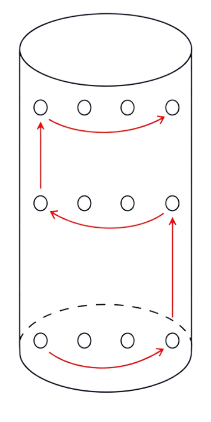
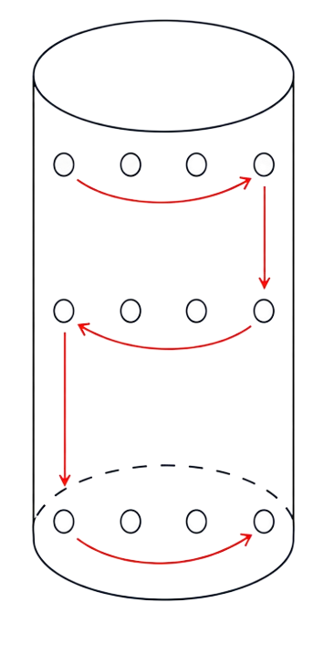
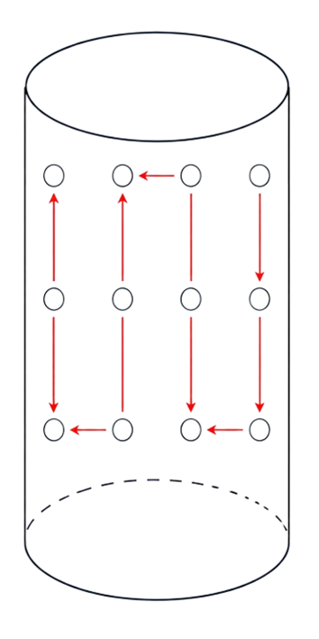
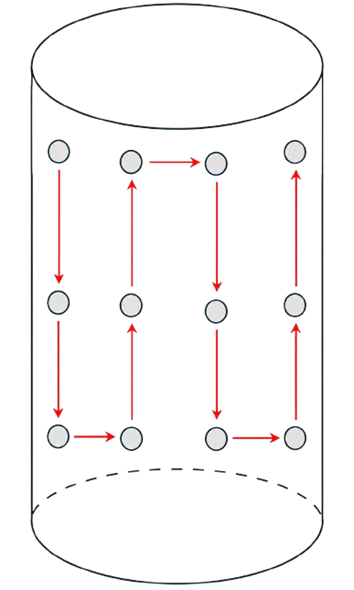
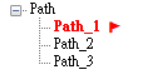

# 路径排序

| 图示 												| 方法 				| 说明 						| 用途 					|
| --- 												| --- 				| --- 						| --- 					|
|  			| **自动排序** 		| 基于最近邻算法自动计算最优加工顺序 		| 减少空移距离，提高加工效率 	|
|  		| **手动排序** 		| 由用户手动指定路径的加工顺序 		| 适用于对加工顺序有特殊要求的情况 		|
|

## 自动排序

自动排序基于最近邻算法，自动计算所有路径的最优加工顺序，最大限度缩短空移距离

| 排序方式 	    | 说明 		        |
| --- 	        | --- 			    | 
| **最短路径**  | 以选定起点为基准，计算所有路径的最短空移顺序 	         |
| **圆管直排**  | 适用于圆管类零件，沿拉伸轴方向从上到下或从下到上排序 		    | 
| **圆管横排**  | 适用于圆管类零件，沿圆周方向顺时针或逆时针排序 		    | 
|

### 操作步骤（最短路径）

 1. 选择一条路径作为排序起点（仅支持单选）
 2. 点击 **自动排序** 按钮
 3. 软件自动计算并重新排列所有路径顺序

### 操作步骤（圆管横排）

    
     

| 参数 				| 说明 										| 默认值 	|
| --- 				| --- 										| --- 		|
| **圆管轴向** 		| 分为 X 轴、Y 轴、Z 轴 	| Z 轴 	|
| **拉伸轴方向** 		| 分为从上到下、从下到上			| 从上到下 	|
| **分组带宽** 	| 每组特征的区间宽度 		| 2 mm 		|
|

 2. 点击 **自动排序** 按钮，在弹出的对话框中选择排序方式为 **圆管横排** 并设置参数
 3. 点击 **确定**，软件自动计算并重新排列所有路径顺序

### 操作步骤（圆管直排）

    
     

| 参数 				| 说明 										| 默认值 	|
| --- 				| --- 										| --- 		|
| **圆管轴向** 		| 分为 X 轴、Y 轴、Z 轴 	| Z 轴 	|
| **旋转轴方向** 		| 分为顺时针、逆时针			| 顺时针 	|
| **分组带宽** 	| 每组特征区间对应的角度 		| 3° 		|
|

 2. 点击 **自动排序** 按钮，在弹出的对话框中选择排序方式为 **圆管直排** 并设置参数
 3. 点击 **确定**，软件自动计算并重新排列所有路径顺序

## 手动排序

| 排序模式 	    | 说明 		        |
| --- 	        | --- 			    | 
| **依次排序**  | 根据用户点击顺序设置新的加工顺序 	    |
| **路径置换**  | 调整个别路径在现有顺序中的前后位置 		    | 
|

### 操作步骤（依次排序）

 1. 点击 **手动排序** 按钮，进入排序模式
 2. 在 3D 视图中点击一条路径
 3. 点击 **置顶**，该路径将移至路径列表最上方，并放置旗标

     

 4. 在 3D 视图中依次点击其他路径
 5. 每点击一条路径后，按下 **Enter** 将其排在当前旗标路径之后
 6. 路径的点击顺序即为新的加工顺序
 7. 完成后退出排序模式

> 💡 **提示**
>
> 双击路径也可放置旗标

### 操作步骤（路径置换）

 1. 点击 **手动排序** 按钮，进入排序模式
 2. 在 3D 视图中点击一条路径
 3. 点击 **往前移动** 或 **往后移动** 按钮，调整该路径在顺序中的位置
 4. 完成后退出排序模式

> 💡 **提示**
>
> 排序完成后，可开启视图控制栏的 **显示顺序** 选项，查看路径顺序编号是否符合预期，详见[《主界面与基本操作》](../1_軟體介紹/1_2_主介面.md)
