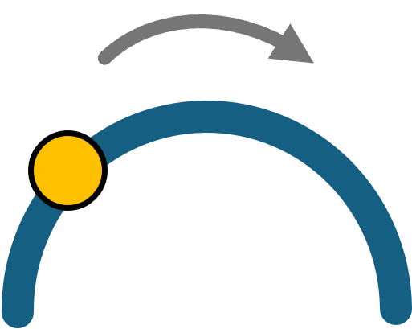
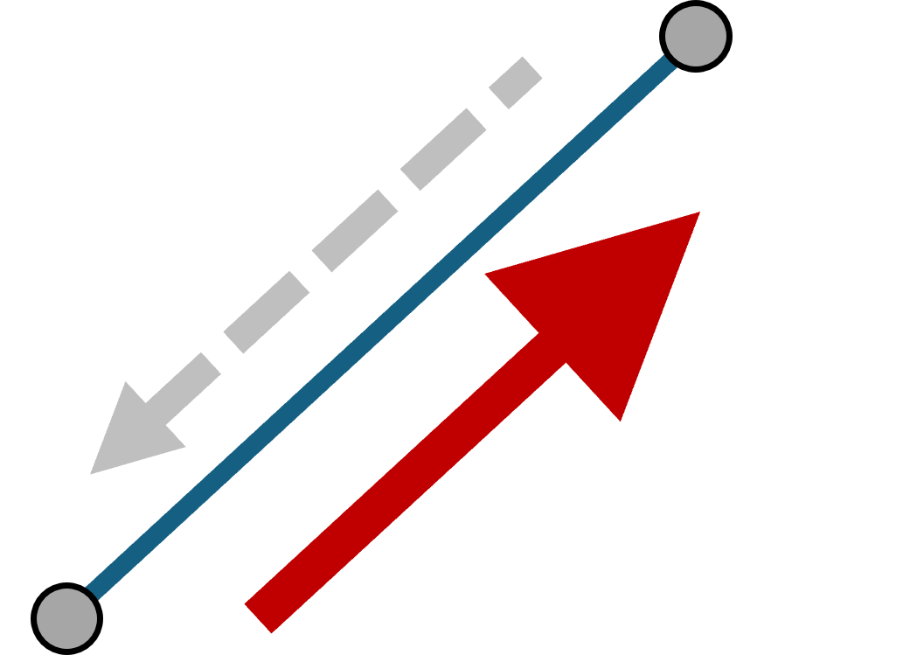
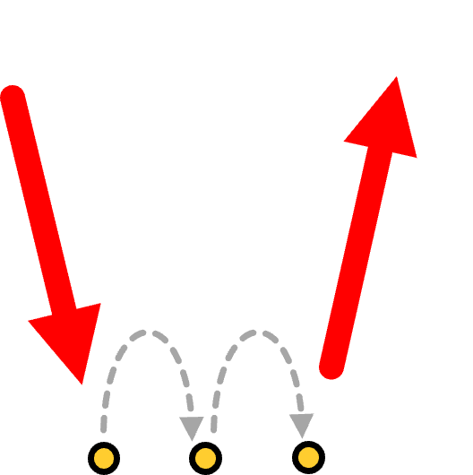
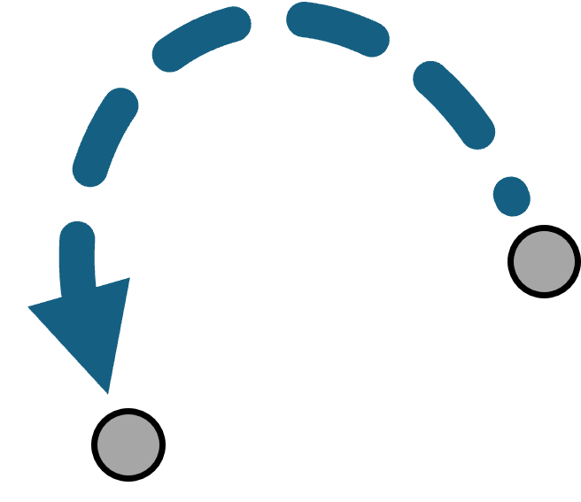
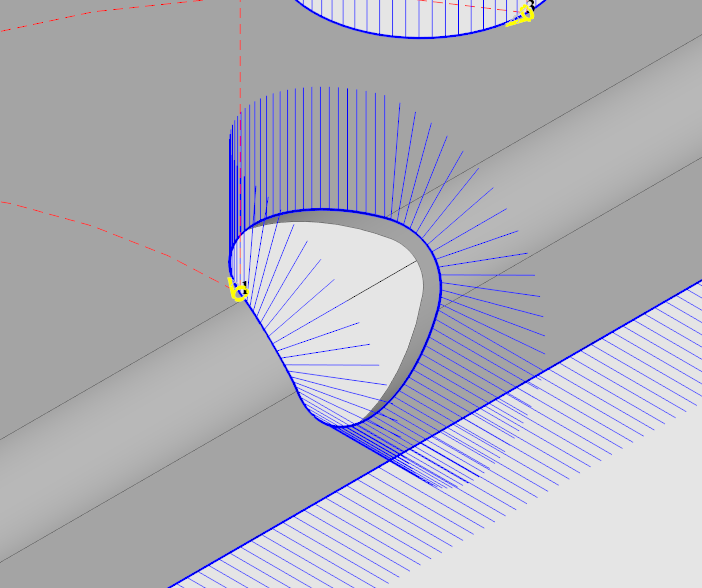
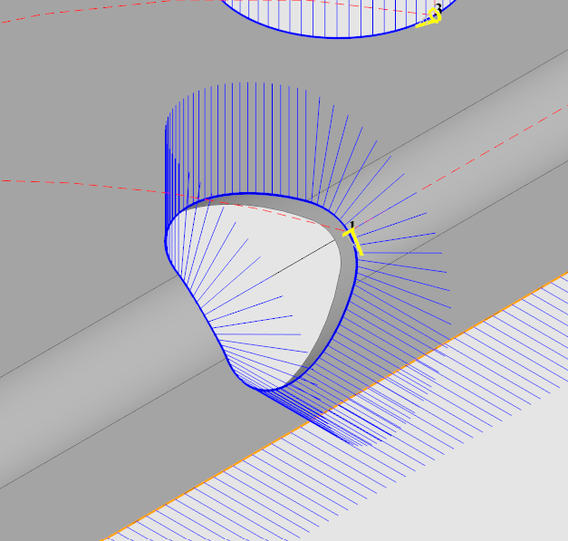
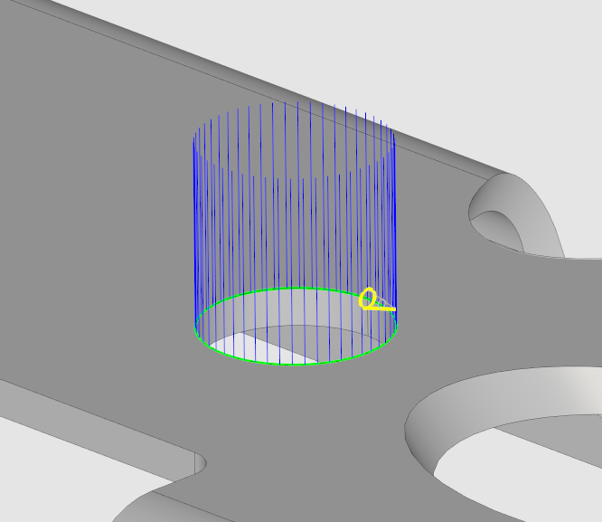
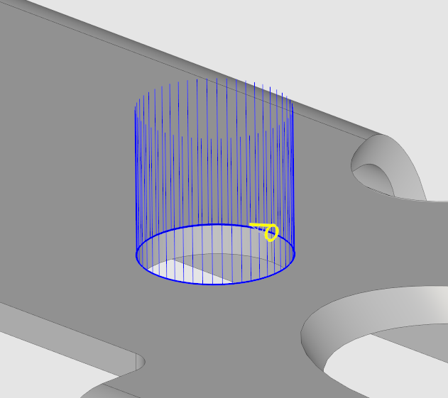
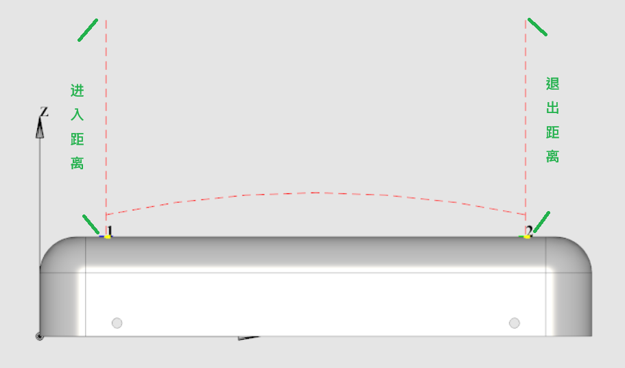
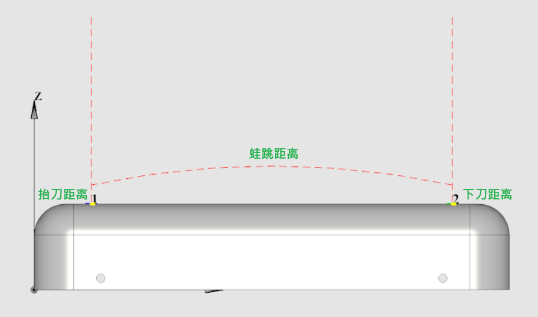

# 路径工序

用于控制加工的执行顺序和刀具的移动方式

| 图示 												| 方法 				| 说明 						                    | 用途 					                            |
| --- 												| --- 				| --- 						                    | --- 					                            |
|  	| **起点** 		    | 修改闭合路径的切割起始位置 		            | 调整引线和过切的生成位置，避免影响工件外观 	    |
|  			| **反向** 		    | 反转路径的切割方向 		                    | 优化加工质量，降低刀具负载 		                |
|  		| **进入／退出**     | 设置刀具进入加工区域及退出至安全位置的距离    | 确保刀具安全移动，避免与工件或夹具碰撞 		    |
|  		| **空移** 		    | 设置刀具在路径之间非切割移动的轨迹            | 避免空移过程中刀具碰撞工件或夹具，缩短空移时间    |
|

## 起点

### 操作步骤

 1. 选择一条闭合路径（仅支持单条路径）

     

 2. 点击 **起点** 按钮
 3. 在路径上点击选择新的起点位置
 4. 路径自动从新起点开始

     

 5. 按 **Esc** 键退出起点设置模式

> 💡 **提示**
>
> - 仅闭合路径支持起点设置；选择起点时，建议避开工件的外观重要区域

## 反向

### 操作步骤

1. 选择路径（支持多选）

     

2. 点击 **反向** 按钮
3. 路径方向立即反转
4. 黄色方向箭头指示新方向

     

> 💡 **提示**
>
> - 反向操作为即时切换，再次点击可恢复原方向

## 进入／退出

     

| 参数 				| 说明 										| 默认值 	|
| --- 				| --- 										| --- 		|
| **进入距离** 		| 刀具从安全位置移动到第一条路径起点的距离 	| 100 mm 	|
| **退出距离** 		| 最后一条路径结束后刀具退出的距离 			| 100 mm 	|
| **随动安全距离** 	| 进入下刀到表面时提前下随动的安全距离 		| 0 mm 		|
|

### 操作步骤

 1. 点击 **进入／退出** 按钮（不依赖路径选择）
 2. 在对话框中设置进入距离和退出距离
 3. 点击 **确定** 应用设置

## 空移

     

| 参数 				| 说明 										| 默认值 	|
| --- 				| --- 										| --- 		|
| **抬刀距离** 		| 切割完成后刀具沿姿态方向抬起的距离 		| 0 mm 		|
| **下刀距离** 		| 刀具接近路径时沿姿态方向下切的距离 		| 0 mm 		|
| **随动安全距离** 	| 下刀到表面时提前下随动的安全距离 			| 0 mm 		|
| **蛙跳距离** 		| 蛙跳式空移的弧顶高度 						| 10 mm 	|
| **安全平面距离** 	| 安全平面的高度，用于需要抬刀避让的情况 	| 20 mm 	|
| **启用安全平面** 	| 是否使用安全平面进行空移 					| 否 		|
|

### 操作步骤

 1. 选择路径（支持多选）
 2. 点击 **空移** 按钮
 3. 在对话框中设置空移参数
 4. 点击 **确定** 应用设置

