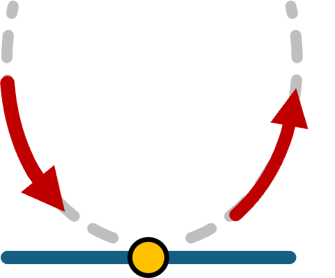
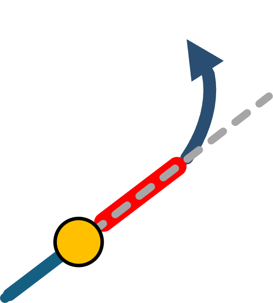
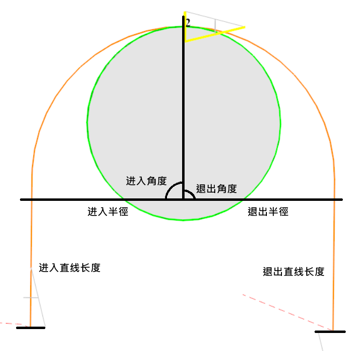
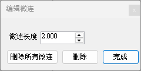
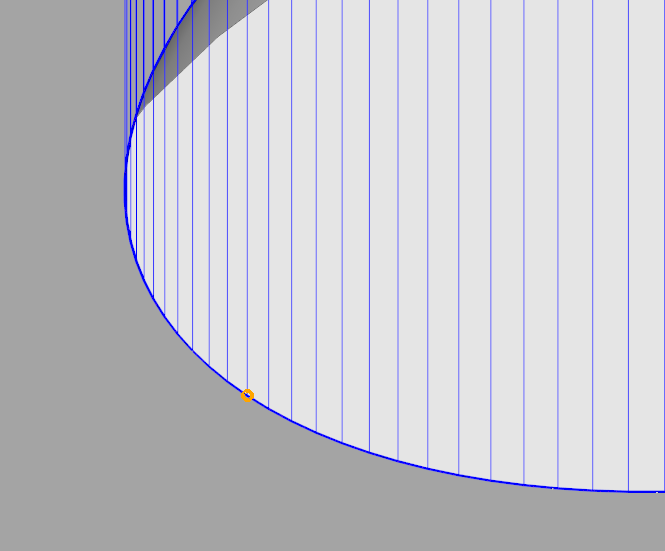
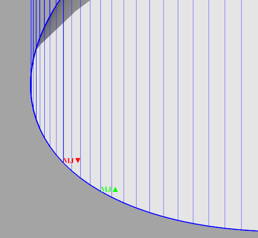

# 路径工艺

用于设置切割过程中的引线、过切和微连参数，影响加工质量和零件完整性

| 图示 										| 方法 				| 说明 						| 用途 					|
| --- 											| --- 				| --- 						| --- 					|
|  			| **引线** 		| 用于生成刀具进入和退出切割路径时的过渡段 		| 避免在工件上留下明显的起刀痕迹	|
|  		| **过切** 		| 用于确保闭合路径完全闭合 		| 	在路径终点超出起点一段距离，避免留下未切割的小缺口	|
|  	| **微连** 		| 用于在切割路径上保留小的连接点 		| 	防止切割完成后零件掉落或移动	|
|

## 引线

 - 由直线段和圆弧段组合而成

     

| 参数 				| 说明 						| 默认值 	| 建议范围 	|
| --- 				| --- 						| --- 		| --- 		|
| **进入直线长度** 	| 进入路径前的直线段长度 	| 0 mm 		| 3～10 mm 	|
| **进入半径**  	| 进入路径的圆弧半径 		| 0 mm 		| 3～10 mm 	|
| **进入角度** 		| 引入方向与路径的夹角 		| 90° 		| 30～120° 	|
| **退出直线长度** 	| 退出路径的直线段长度 		| 0 mm 		| 3～10 mm 	|
| **退出半径**  	| 退出路径的圆弧半径 		| 0 mm 		| 3～10 mm 	|
| **退出角度** 		| 引出方向与路径的夹角 		| 90° 		| 30～120° 	|
| **引线反向**  	| 切换引线在路径内侧或外侧 	| 否 		| - 		|
|

### 操作步骤

 1. 选择路径（支持多选，仅闭合路径可用）
 2. 点击 **引线** 按钮
 3. 在对话框中输入引入和引出参数
 4. 点击 **确定** 应用设置

## 过切

| 参数 			| 说明  			| 默认值 	| 建议范围 	|
| --- 			| --- 				| --- 		| --- 		|
| **过切长度** 	| 超出闭合点的距离 	| 0 mm 		| 0.5～3 mm 	|
|

### 操作步骤

1. 选择闭合路径（支持多选）
2. 点击 **过切** 按钮
3. 输入过切长度
4. 点击 **确定** 应用

## 微连

| 参数 			| 说明 						| 建议范围 	|
| --- 			| --- 						| --- 		|
| **微连长度** 	| 连接点沿路径方向的长度 	| 2～5 mm 	|
|

### 操作步骤

1. 选择一条路径（仅支持单条路径）
2. 点击 **微连** 按钮
3. 在 3D 视图中点击路径上的点，添加微连位置

    
    
     

4. 在对话框中调整微连长度
5. 可通过 **删除** 按钮删除选中的微连点，或通过 **全部清除** 删除所有微连点
6. 按 **Esc** 键退出微连设置模式

> 💡 **提示**
>
> - 微连点以特殊标记显示，已添加的微连点可再次点击选中后修改长度或删除

