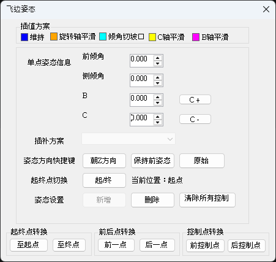
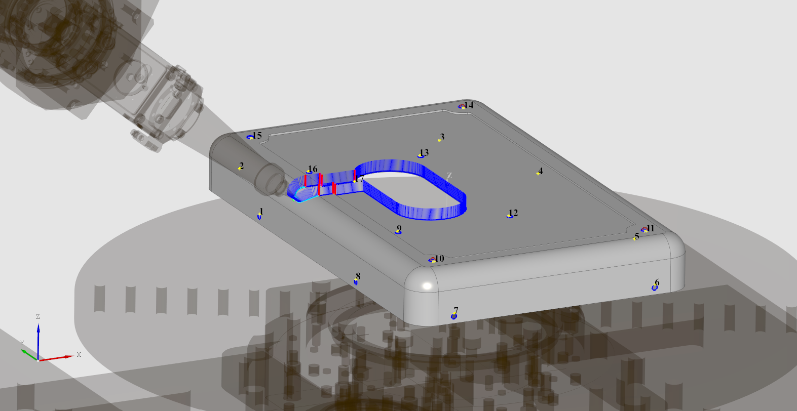
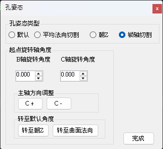
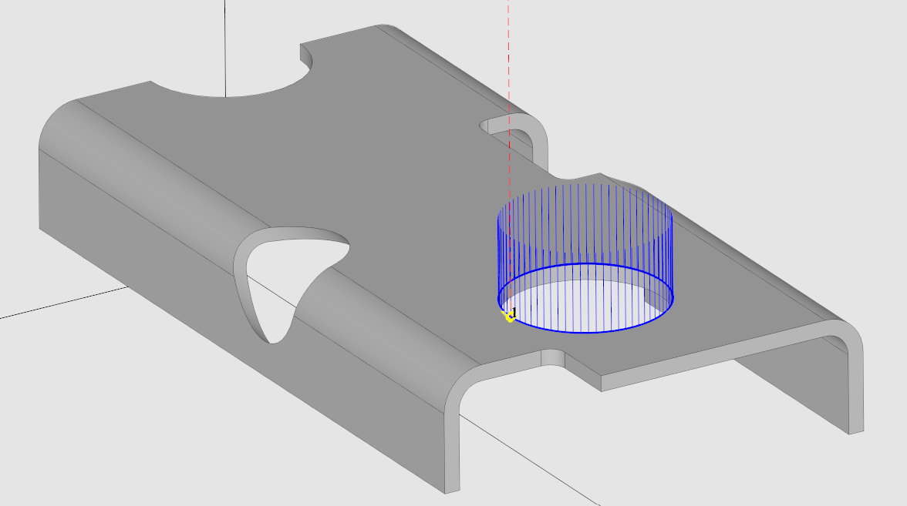
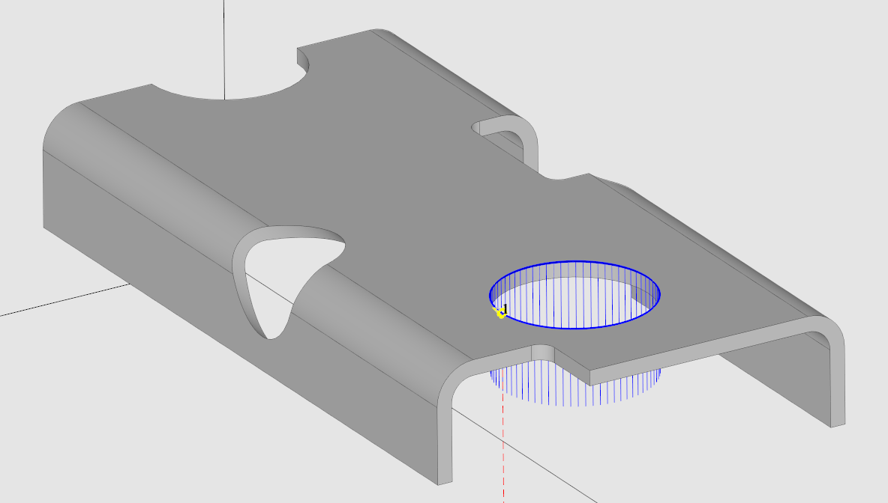

# 路径姿态

路径姿态决定了激光束相对于工件表面的角度，直接影响加工质量；姿态以红色箭头表示刀具方向

| 图示 												| 方法 				| 说明 										| 用途 																|
| --- 												| --- 				| --- 										| --- 																|
|  			| **飞边姿态** 		| 对路径上各点的刀具姿态进行精确手动调整	| 精细调整飞边部位的切割姿态 										|
|  		| **孔姿态** 		| 将所有路径点的姿态统一设置为相同方向 		| 使整条路径以固定角度切割，适用于孔位等稳定切割角度的场景 			|
|  	| **姿态反向** 		| 将所有路径点的姿态向量反向 180° 			| 快速切换刀具朝向 													|
|  		| **优化轴向** 		| 自动优化多条路径之间旋转轴的连续性 		| 提高多路径加工时的平滑度，避免相邻路径切换时旋转轴产生大幅度跳变 	|
|

## 飞边姿态

 - 可逐点设置倾斜角度和旋转轴角度
 - 支持插值方式控制相邻点之间的姿态过渡

| 参数 			    | 说明 					                | 范围 			|
| --- 			    | --- 					                | --- 			| 
| **前倾角** 		| 沿路径方向倾倒的角度 		            | -90°～+90° 	|
| **侧倾角**		| 垂直于路径方向的侧向倾斜角度 		    | -90°～+90° 	| 
| **B轴（从轴）** 	| 机床 B 轴（从轴）目前的旋转角度数值   | - 			| 
| **C轴（主轴）** 	| 机床 C 轴（主轴）目前的旋转角度数值   | - 			| 
| **插补方案**		| 相邻控制点之间的姿态过渡方式 		    | -				|
|

| 插补方案              | 说明                                      |
| ---                   | ---                                       |
| **旋转轴平滑**        | 平滑相邻控制点之间的主／从轴角度变化      |
| **倾角切坡口**        | 根据前倾角与侧倾角产生连续变化的坡口姿态  |
| **C轴（主轴）平滑**   | 平滑相邻控制点之间的主轴角度变化          |
| **B轴（从轴）平滑**   | 平滑相邻控制点之间的从轴角度变化          |
|

     
    <b>飞边姿态设置窗口</b> 

### 操作步骤

 1. 选择一条轮廓路径（仅支持单条路径）
 2. 点击 **飞边姿态** 按钮
 3. 在 3D 视图中点击路径点，选择要调整的点
 4. 可通过 **新增** 和 **删除** 管理姿态控制点
 5. 设置前倾角、侧倾角，并选择插补方案
 6. 使用 **前一点／后一点** 按钮在路径点之间导航

     
    <b>飞边姿态设置示意图</b> 

> 💡 **提示**
>
> - 姿态调适过程中会显示机床模型，用于实时预览姿态变化对机床运动的影响

## 孔姿态

根据选择的计算方式，将姿态应用到整条路径；除锁轴切割外，其余方式均由软件自动计算，无需设置额外参数

| 类型 				| 说明 						|
| --- 				| --- 						| 
| **默认** 		| 使用垂直边的法向量作为切割姿态 		| 
| **平均法向切割**		| 以路径范围内表面法向量的平均方向作为切割姿态 		| 
| **朝 Z**	| 将姿态方向统一设置为与 Z 轴平行 		| 
| **锁轴切割** 	| 锁定主／从旋转轴角度，以固定轴向角度进行切割 		| 
|

### 操作步骤

 1. 选择轮廓路径（支持多选）
 2. 点击 **孔姿态** 按钮
 3. 选择 **默认**、**平均法向切割**、**朝 Z** 或 **锁轴切割**
 4. 若选择 **锁轴切割**，输入主、从轴角度；其他方式无需设置额外参数
 5. 点击 **确定** 应用到所有路径点

### 锁轴切割

     
    <b>锁轴切割设置示意图</b> 

| 参数 				| 说明 						| 范围 			|
| --- 				| --- 						| --- 			|
| **B轴（从轴）**	| 锁定后机床从轴的角度数值 		| - 			| 
| **C轴（主轴）**	| 锁定后机床主轴的角度数值 		| - 			| 
|

> 💡 **提示**
>
> - 锁轴切割适用于对姿态变化要求不高、但需要稳定切割角度的场景

## 姿态反向

### 操作步骤

 1. 选择路径（支持多选）

     

 2. 点击 **姿态反向** 按钮
 3. 所有姿态向量立即反向

     

## 优化轴向

### 操作步骤

 1. 点击 **优化轴向** 按钮
 2. 软件按照路径加工顺序，以前一条路径末尾的旋转轴角度作为下一条路径的初始值，重新计算逆运动学解
 3. 完成后所有路径的姿态自动更新

> 💡 **提示**
>
> - 确保所有路径已生成且已完成排序
