# 路径编辑

用于对已生成的路径进行几何变换和轮廓微调

| 图示 										            | 方法          | 说明 						                                    | 用途 					        |
| --- 											        | --- 	        | --- 						                                    | --- 					        |
| 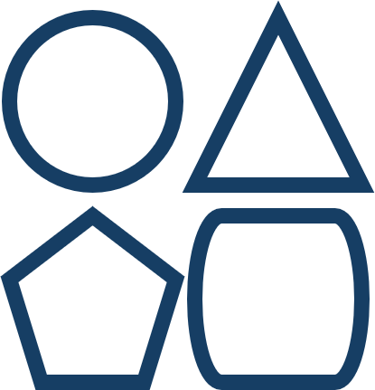    | **标准图元**  | 将路径转换为圆形、矩形、跑道形或正多边形等标准图形            | 快速将轮廓调整为常用形状      |
| 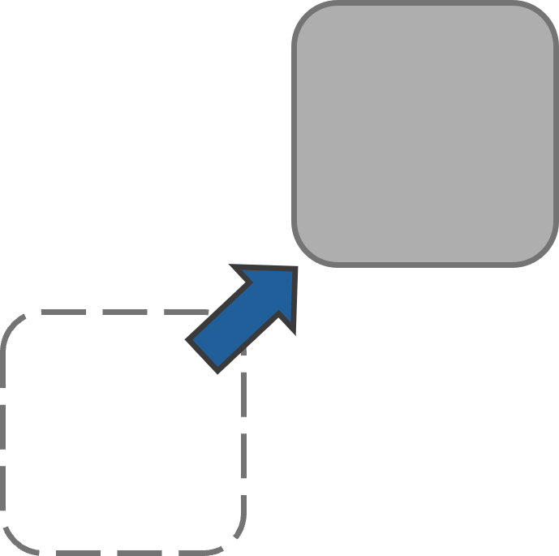 			| **位置补偿**  | 对选中的路径进行整体平移，可沿 X、Y、Z 三个方向移动路径位置   | 调整路径整体位置 	            |
| 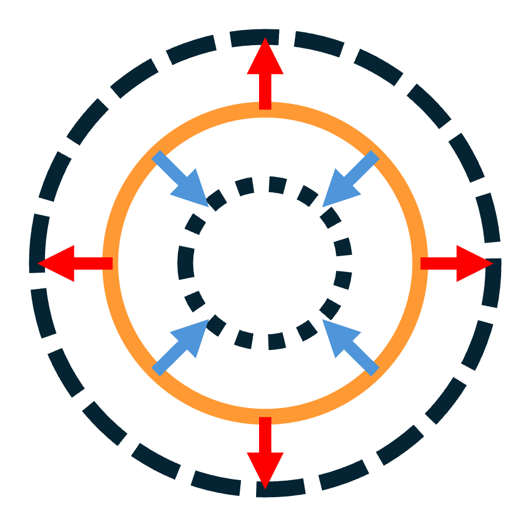     | **尺寸补偿**  | 将路径整体向内或向外偏移，补偿激光束宽度或刀具半径 		    | 使实际切割尺寸符合设计要求    |
| 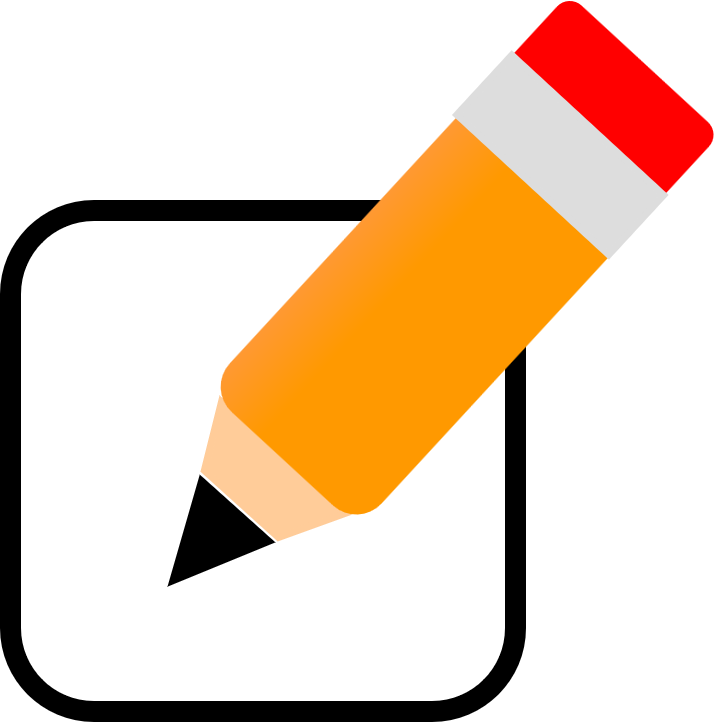 		| **轮廓编辑**  | 对单条轮廓路径上的个别点进行位移微调 		                    | 实现局部轮廓修正 		        |
|

## 标准图元

| 图元类型 	    | 说明                                                                          | 
| ---           | --- 	                                                                        | 
| **轮廓** | 保留原始轮廓          | 
| **圆形** | 设置直径、旋转角度 |
| **矩形** | 设置长、宽、圆角半径、旋转角度          | 
| **跑道形** | 设置长、宽、旋转角度          | 
| **正三角形、正方形、正五边形、正六边形** | 设置边长、圆角半径、旋转角度          | 
|

 **坐标反转** ：勾选后，图元将以相反的坐标方向生成

> 💡 **提示**
>
> - 支持对多个已选路径同时应用相同的图元和尺寸
> - 转换图元时沿用原轮廓的参考中心和方向

### 操作步骤

 1. 选择一个或多个路径
 2. 点击 标准图元 按钮
 3. 选择图元，并设置对应参数
 4. 确认预览结果后，点击 确定 应用

    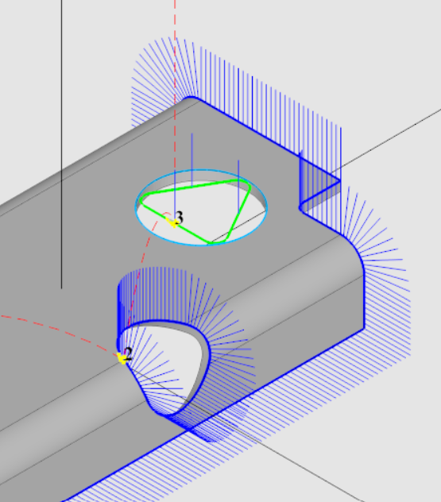
    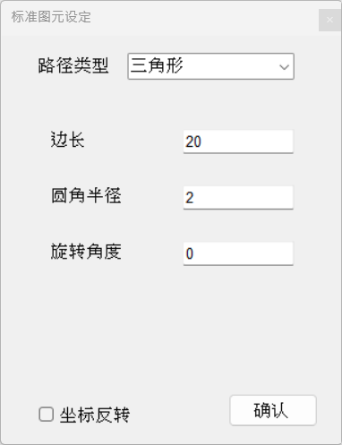 

## 位置补偿

| 坐标系 	    | 说明                                                                          | 
| ---           | --- 	                                                                        | 
| **局部坐标系** | 以所选路径自身的局部原点与方向为基准，平移量仅作用于该路径所在的局部坐标轴向 |
| **世界坐标系** | 以整个模型／工件的全局坐标系为基准，平移量沿全局 X、Y、Z 轴方向应用          | 
|

### 操作步骤

 1. 选择路径（支持多选）

    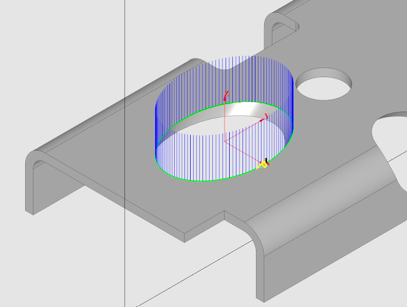 

 2. 点击 **位置补偿** 按钮
 3. 在对话框中选择参考坐标系类型
 4. 输入 X、Y、Z 方向的平移量
 5. 点击 **确定** 应用，或点击 **重置** 清除所有累计位移

    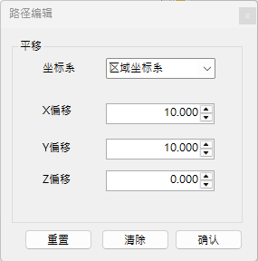
    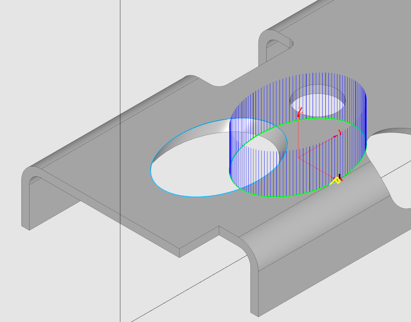 

> 💡 **提示**
>
> - 路径编辑的位移量会累计叠加，使用 **重置** 按钮可将位移归零

## 尺寸补偿

### 操作步骤

 1. 选择路径（支持多选）

    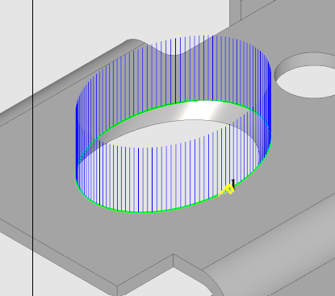 

 2. 点击 **尺寸补偿** 按钮
 3. 输入补偿距离（正值使加工尺寸变大，负值使加工尺寸变小）
 4. 点击 **确定** 应用，或点击 **重置** 将补偿值归零

 

    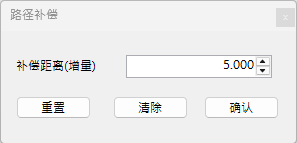
    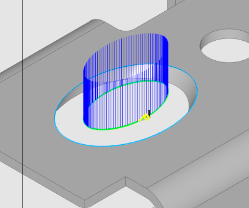 

> 💡 **提示**
>
> - 补偿距离会累计叠加，使用 **重置** 按钮可将补偿值归零
> - 如果补偿值过大导致路径自交，软件会提示几何约束超限

## 轮廓编辑

### 操作步骤

 1. 选择一条轮廓路径（仅支持单条轮廓路径）

    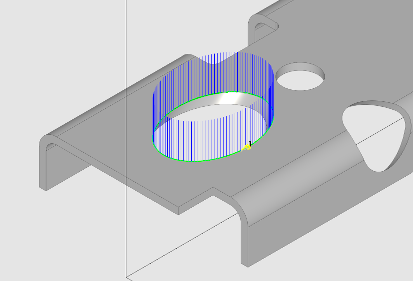 

 2. 点击 **轮廓编辑** 按钮
 3. 在 3D 视图中点击选择路径上的点

    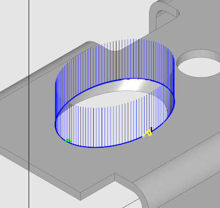 

 4. 点击 **添加编辑点** 将当前点标记为可编辑
 5. 输入 X、Y、Z 方向的位移量

    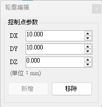
    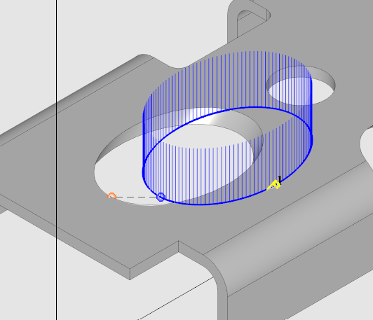 

 6. 可通过 **移除** 取消某个点的编辑
 7. 按 **Esc** 键退出轮廓编辑

> ⚠️ **注意**
>
> - 此功能仅支持轮廓类型（Contour）的路径，标准图案路径暂时不支持轮廓编辑

