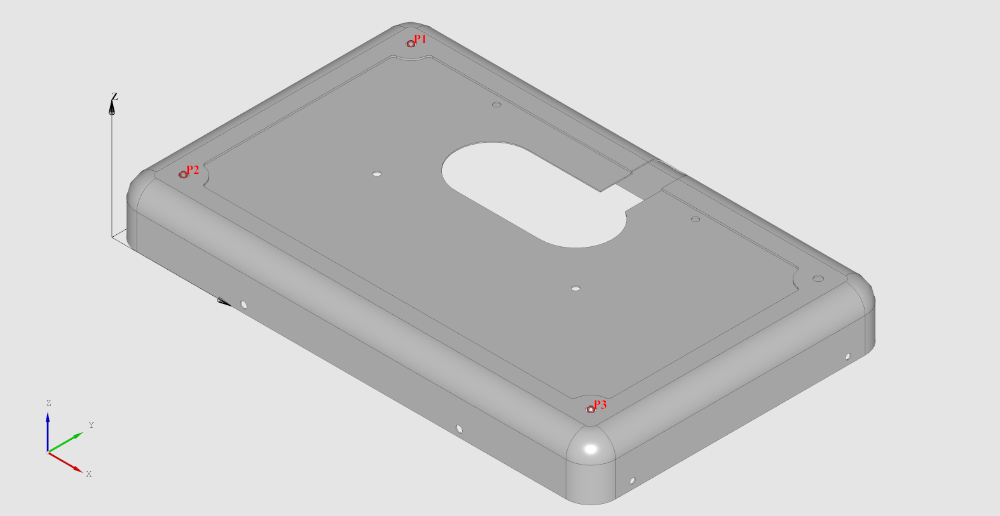
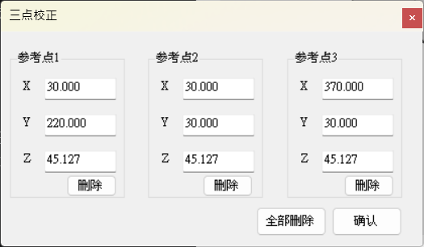

# 程序输出

| 图示 											| 方法 		    | 说明 						                            | 用途 					                                    |
| --- 										    | --- 	        | --- 						                            | --- 					                                    |
|     | **三点校正**  | 对齐实际加工坐标与编程坐标，并自动调整所有路径 		| 校正工件安装偏移，提高重复加工精度，并用于批量生产对齐 	|
|  		| **转出NC**    | 将加工路径和参数转换为机床可执行的 NC 程序文件 		| 输出 NC 程序文件，以保存至本地或传输至 CNC 控制器 		|
|

## 三点校正

### 操作步骤

 1. 确保已导入工件模型
 2. 点击 **三点校正** 按钮
 3. 在 3D 视图中依次点击工件上对应编程坐标的三个特征点（顶点）
 4. 在对话框中输入对应的实际测量坐标
 5. 点击 **确定** 应用校正

 

    
     

### 对话框

 - 删除点：选中已设置的校正点后，按 **Delete** 键或点击对话框中的 **删除** 按钮
 - 全部清除：删除所有校正点，重新开始设置

> 💡 **提示**
>
> - 生成的三点校正指令会自动打印到 **NC** 程序中

## 转出NC

### 操作步骤

 1. 点击 **转出NC** 按钮
 2. 在保存对话框中选择保存位置
 3. 输入文件名（自动添加 **.nc** 扩展名）
 4. 点击 **保存** 按钮
 5. 软件生成 **NC** 程序文件

### 文件传输

 - 如果已设置 CNC 控制器 IP 地址，NC 文件会自动传输到控制器
 - 如果未设置连接，仅保存到本地

### 自定义后处理

 - 配置文件：`CustPost.txt`
 - 文件位置：软件安装目录

> ⚠️ **注意**
>
> ### 输出前检查
>
> - 所有路径已生成完成
> - 路径顺序正确
> - 姿态调整无误
> - 引线、过切、微连已设置
> - 无碰撞风险（通过模拟验证）
