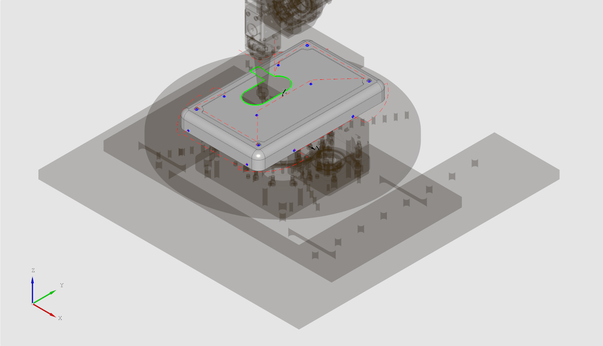

# 路径模拟

路径模拟功能可以在虚拟环境中重现加工过程，验证路径的正确性和安全性

| 图示 | 方法 | 说明 |
| --- | --- | --- |
|  | **播放** | 开始或继续播放模拟 |
|  | **暂停** | 暂停模拟播放 |
|  | **停止** | 停止并重置模拟 |
|  | **上一路径** | 跳转到上一条路径 |
|  | **下一路径** | 跳转到下一条路径 |
|  | **上一步** | 跳转到上一个路径点 |
|  | **下一步** | 跳转到下一个路径点 |
|  | **快进** | 加快播放速度 |
|  | **慢放** | 减慢播放速度 |
|  | **碰撞检查** | 执行全局碰撞计算，完成后显示碰撞检查结果窗口 |
|  | **上一碰撞点** | 跳转到上一个碰撞点 |
|  | **下一碰撞点** | 跳转到下一个碰撞点 |

## 模拟目的

 - 验证路径顺序是否正确
 - 检查刀具姿态是否合理
 - 预览加工效果
 - 发现潜在的碰撞问题

> 💡 **提示**
>
>  - 使用慢速播放可以更清楚地观察细节
>  - 可以在播放过程中旋转视图查看不同角度

## 碰撞检查

 1. 点击 **碰撞检查** 按钮，执行所有加工路径的碰撞计算
 2. 等待计算完成，软件会显示碰撞检查结果窗口
 3. 若检查结果发现碰撞，可使用 **上一碰撞点** 与 **下一碰撞点** 逐一查看碰撞位置

## 模拟结果分析

模拟过程中，请检查以下项目

 - **路径顺序检查**：确认路径按预期顺序执行，无跳跃或不合理移动
 - **姿态检查**：确认姿态向量垂直于工件表面，且变化平滑
 - **空移检查**：确认抬刀高度足够
 - **干涉检查**：确认加工过程无碰撞干涉

     
    <b>模拟过程示意</b>

